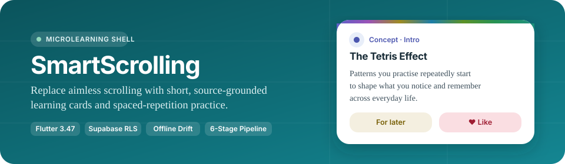
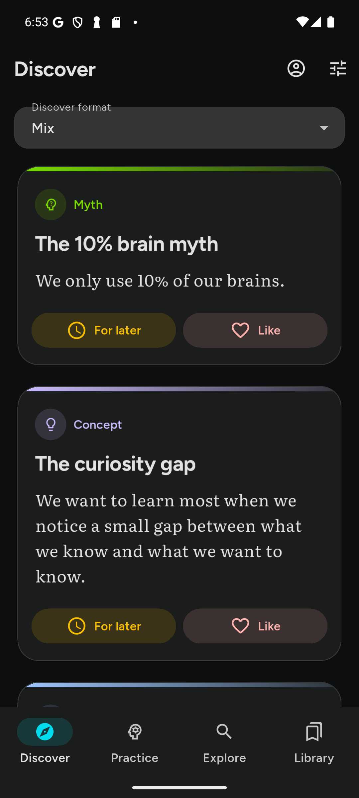
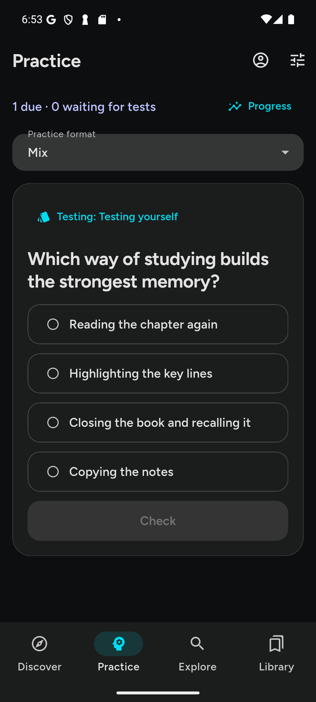
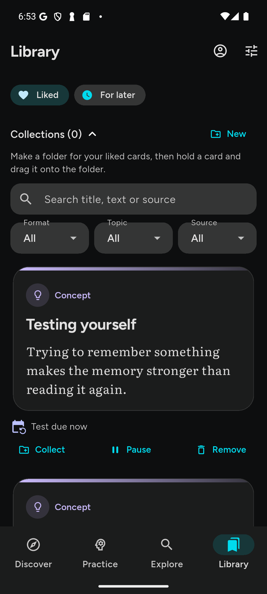
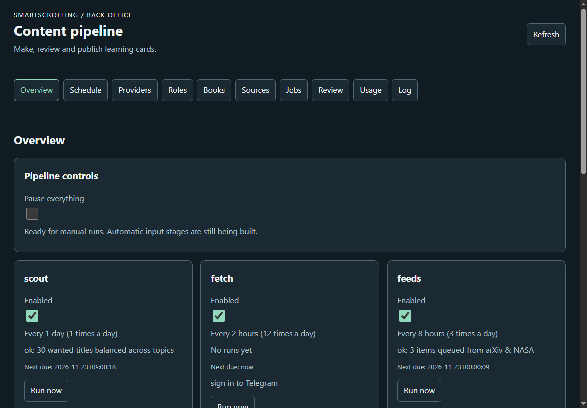

<p align="center">
  
</p>

<p align="center">
  <a href="#the-mobile-app">Mobile App</a> •
  <a href="#how-things-work-together">Architecture</a> •
  <a href="#backend-supabase">Backend</a> •
  <a href="#autonomous-content-pipeline">Content Pipeline</a> •
  <a href="#run-and-verify">Run &amp; Verify</a> •
  <a href="#project-map">Project Map</a>
</p>

<p align="center">
  <em>A calm, offline-first Flutter microlearning app backed by Supabase RLS/RPCs and fed by a local, six-stage, quality-gated AI content factory.</em>
</p>

---

SmartScrolling replaces aimless feeds with two focused loops: **Discover** (read, watch, or listen to short, source-grounded cards) and **Practice** (spaced-repetition testing on everything you liked). It ships as a clean, multi-user-isolated shell: an autonomous local content pipeline turns books, papers, open articles, artworks, and licensed news into verified cards and tests outside the app, then publishes them into Supabase with zero app code changes.

<table align="center">
  <tr>
    <td align="center" width="33%">
      <br>
      <sub><b>Discover</b> · Format-coded cards &amp; gestures</sub>
    </td>
    <td align="center" width="33%">
      <br>
      <sub><b>Practice</b> · 5 spaced-repetition test types</sub>
    </td>
    <td align="center" width="33%">
      <br>
      <sub><b>Library</b> · Collections, filters &amp; due dates</sub>
    </td>
  </tr>
</table>

---

## How Things Work Together

SmartScrolling separates **consumption & spaced repetition** (Flutter + local Drift DB), **multi-tenant state & storage** (Supabase Postgres + RLS), and **content generation** (local Python pipeline):

```mermaid
flowchart LR
  subgraph PC["Back Office · Local PC (Python stdlib + Telethon)"]
    SC["1 · scout<br>Open Library + Prizes"] --> WL[(books)]
    WL --> FE["2 · fetch<br>Telegram + inbox/"]
    FD["3 · feeds<br>13+ public/licensed readers"] --> MK["4 · make<br>14-step cardmaker + gates"]
    FE --> MK
    RQ["6 · requests<br>Guarded DB rebuild"] --> MK
    MK --> PB["5 · publish<br>upload.py + verify + archive"]
    DASH["Local Dashboard<br>127.0.0.1:8765"] -.-> PC
  end

  subgraph SUPA["Backend · Supabase"]
    AUTH["Google Auth"]
    PG[("Postgres · 22 Tables<br>RLS + 9 invoker RPCs")]
    B1[("source-files<br>private · service role")]
    B2[("media<br>1h signed URLs")]
  end

  subgraph APP["Mobile App · Flutter 3.47"]
    UI["13 Screens<br>Provider + GoRouter"]
    REPO["9 Repositories"]
    DRIFT[("Drift v4 SQLite<br>Cache + Outbox")]
    UI <--> REPO
    REPO <--> DRIFT
  end

  PB -- "service_role key" --> PG & B1 & B2
  PG -- "content_requests" --> RQ
  REPO <-- "authenticated JWT" --> PG
  REPO <-- "signed URLs" --> B2
```

- **Strict write boundary:** Only the local upload tool (`tools/content/upload.py`, using `SUPABASE_SERVICE_ROLE_KEY`) writes to the 11 content tables and private buckets. The mobile app holds only public keys (`.env.mobile.json`), reads published content through RLS, and writes only the signed-in user's own activity rows.
- **No AI inside the app:** All summarization, card extraction, cross-family judging, quiz writing, and blind solving happen offline on your PC before upload.
- **Offline parity:** When offline, the Flutter app serves cached Discover/Library/Practice data from a per-user Drift v4 SQLite database and queues mutations in an ordered, idempotent outbox.

---

## The Mobile App

Built with **Flutter 3.47.8** / **Dart 3.13.7**, using `provider` + `ChangeNotifier` state classes and `go_router` navigation.

### Screens & Navigation

Four primary tabs sit inside `ShellScreen` (`Discover`, `Practice`, `Explore`, `Library`), paired with top-bar routes and growing detail views:

| Route | Screen | Responsibility |
|---|---|---|
| `/` | `start` | Loads persisted settings & session; retries cleanly on boot failure |
| `/welcome` | `welcome` | Google Sign-In (plus debug-only `Test login` when `.env.test.json` is passed) |
| `/onboarding` | `onboarding` | Up to 3 interest steps grouped by macro topic area (`Continue` / `Skip`) |
| `/discover` | `discover` | Vertical full-card feed, format filter, hold-to-refresh, swipe/tap actions |
| `/practice` | `practice` | Due-test vertical feed (10 at a time), type filter, `Practice now` fallback |
| `/explore` | `explore` | Two-level topic tree + auto-gliding topic chips + literal source search |
| `/library` | `library` | `Liked` & `For later` vertical feeds, search/filters, notes, drag-to-collections, Undo |
| `/source/:id` | `source` | Cover, metadata (`book`/`paper`/`news`/`other`), preview cards, Follow / Hide / Ask for more |
| `/card` | `card` | Expanded card detail & private note editor |
| `/progress` | `progress` | Weekly goal ring, streak/activity metrics |
| `/settings` | `settings` | Theme, accessibility, offline mode & mobile-data cap, reminders, topics, export/delete data |
| `/account` | `account` | Signed-in identity and sign-out |

### 8 Discover Card Formats

<p align="center">
  
</p>

- **Interactions:** Swipe right to **Like** (schedules first review in 1 day); swipe left for **For later**; tap any card for a 3D `CardFlip` revealing compact back context, `See also` related cards, attributed text sharing, **Source page**, and **Report a problem**.
- **Feed physics & refresh:** Scrolling past half a card batches neutral `seen_cards` marks. Pull down on the top card and hold (`0.5s`) — or pull hard (`128px`) — to fetch a fresh batch excluding already loaded cards. Seen cards are gently interleaved back after new cards (1 seen per 10 new, oldest-seen first), while Liked and For later cards leave Discover permanently.
- **Media playback:** `video` and `audio` cards bundle `.vtt` captions, transcripts, poster thumbnails, and persistent playback resume (`saved_for_later.resume_at_seconds` online, `media_resume` locally).

### Practice & Spaced Repetition

- **5 interactive test types:** `flashcard` (*Reveal* → *Again / Hard / Good / Easy*), `multiple_choice`, `true_false`, `ordering` (drag or Up/Down buttons), and `matching` (shuffled right column).
- **Replaceable timetable plug:** Scheduling lives in a single pure-Dart function ([`lib/domain/review_schedule.dart`](lib/domain/review_schedule.dart)) across a **1 · 3 · 7 · 14 · 30 day** ladder (`level 0–4`). Wrong/Again resets to day 1; Hard holds; Good/Correct steps up `+1`; Easy steps up `+2`.
- **Smart test selection:** Each due review picks an unanswered test linked to that Liked card first, then the oldest-answered test (`pick_test` SQL RPC online, [`lib/domain/test_picker.dart`](lib/domain/test_picker.dart) offline — both verified against the same SQL test cases). When all linked tests are exhausted, an open `more_practice` request is queued for the pipeline.

### Design System & Architectural Enforcement

- **Editorial palette ([`lib/core/theme/theme_extensions.dart`](lib/core/theme/theme_extensions.dart)):** Generated from one calm deep-teal seed (`#0F6E78`), pairing near-neutral surfaces (`surfaceContainerLow` / `surfaceContainerLowest`) with HSL-spaced semantic and format hues (`like`, `later`, `correct`, `wrong`, `due`, and 8 format colors).
- **Typography & motion:** Bundled `Figtree` geometric sans for UI/titles + `Literata` serif (`19px`, `1.55` line height) for reading copy. Supports Light, Dark, System, High Contrast, Reduce Motion, and 5 text-scale steps (`0.85x`–`1.20x`).
- **Rule robot ([`test/architecture_test.dart`](test/architecture_test.dart)):** Automatically fails `flutter test` on any file exceeding 250 lines in `lib/screens/` or `lib/core/widgets/`, any helper method returning `Widget`, any raw `Color`/`TextStyle`/spacing/duration literal outside `lib/core/theme/`, any cross-layer import violation, or any unregistered LEGO piece missing from [`lib/core/widgets/README.md`](lib/core/widgets/README.md).

### Offline Engine & Storage Caps

| Offline Mode | Discover Cache | Practice Window | For Later Cache | Total Space Cap | Media Sub-Cap (20%) |
|---|---:|---:|---:|---|---|
| `online_only` | 0 | 0 | 0 | Clears cache (keeps outbox) | — |
| `light` | 200 cards | 80 tests | 20 cards | 256 MB | 51.2 MB |
| `standard` *(default)* | 500 cards | 200 tests | 50 cards | 512 MB | 102.4 MB |
| `extended` | 1,000 cards | 400 tests | 100 cards | 1 GB | 204.8 MB |

---

## Backend (Supabase)

SmartScrolling uses **Supabase Postgres, Auth, and Storage** directly — no intermediate API server.

- **22 RLS-protected tables:**
  - **11 Content tables:** `topics`, `sources`, `book_details`, `paper_details`, `news_details`, `source_topics`, `discover_cards`, `card_topics`, `related_cards`, `practice_cards`, `practice_links`. Read-only for `authenticated` (`status = 'published'`); writable only via service-role key.
  - **11 Personal Activity tables:** `profiles`, `devices`, `user_topics`, `user_sources`, `likes`, `saved_for_later`, `seen_cards`, `practice_answers`, `collections`, `collection_cards`, `content_requests`. Scoped per `user_id = auth.uid()` with zero access for `anon`.
- **9 `security invoker` SQL RPCs** (`set search_path = ''`):
  - `discover_feed` — level priority, Like-topic affinity, round-robin source interleaving, hide-beats-follow, expired news filtering, and 10:1 seen-card interleaving.
  - `search_sources` — case-insensitive substring search across title, authors, topics, and main areas with published card counts.
  - `like_card`, `save_for_later`, `undo_like` — atomic feed mutations (creating a `likes` row removes `saved_for_later`, marks seen, and opens `more_practice` if no published test exists).
  - `pick_test`, `record_answer` — idempotent UUID-keyed answer logging, row-locked timetable updates (latest `answered_at` wins), and automatic `more_practice` request creation.
  - `export_my_data`, `delete_my_data` — full JSON export across all 11 personal tables and atomic activity wipe (preserving account, content, and reset `profiles`/`devices` rows).
- **2 Private Storage Buckets** (50 MB max per file):
  - `source-files` — stores raw originals (`original.pdf`/`.epub`/`.html`/`.txt`) and extracted `text.txt`; accessible **only** by the service-role key.
  - `media` — stores source covers and card media/posters/`.vtt` captions; served to authenticated users via 1-hour signed URLs.

<details>
<summary>Database schema &amp; migrations breakdown (13 migrations · 5 rollback SQL test suites)</summary>

| Migration | Purpose |
|---|---|
| `20261030100000_helpers.sql` | Triggers (`touch_updated_at`, `bump_version`, `bump_revision`) & structural checks (`check_topic_levels`, `check_source_kind`, `check_news_card`) |
| `20261030100100_content_tables.sql` | 11 content tables with inline Postgres comments |
| `20261030100200_activity_tables.sql` | 11 personal activity tables & constraints |
| `20261030100300_access_rules.sql` | Enables RLS across all 22 tables; revokes `anon` privileges |
| `20261030100400_storage.sql` | Creates `source-files` and `media` private buckets + read policy |
| `20261030110000_discover_functions.sql` | `discover_feed`, `like_card`, `save_for_later`, `undo_like` |
| `20261030120000_practice_functions.sql` | `pick_test`, `record_answer`, history index |
| `20261030120100_practice_mix_types.sql` | Mix filter support across practice types |
| `20261030130000_explore_personalization.sql` | Like-affinity ranking in `discover_feed` + `search_sources` |
| `20261031133718_practice_all_types.sql` | Full 5-type support in `pick_test` |
| `20261031160000_your_data.sql` | `export_my_data`, `delete_my_data` |
| `20261103120000_text_scale_range.sql` | Widens `devices.text_scale` constraint (`0.8`–`1.8`) |
| `20261103130000_discover_feed_repeats.sql` | D46 seen-card interleaving in `discover_feed` |

</details>

---

## Autonomous Content Pipeline

The back office lives in [`tools/content/pipeline/`](tools/content/pipeline/) and [`tools/content/cardmaker/`](tools/content/cardmaker/) (Python 3.13 standard library + `telethon` / `qrcode` for Telegram book intake). All working state, SQLite queue (`pipeline.db`), Telegram session, and logs stay outside Git under `PIPELINE_HOME` (`%USERPROFILE%\SmartScrollingContent`).

### 6 Scheduled Stages (`tick` every 10 minutes)

Running in reverse-drain order (`publish` → `make` → `requests` → `fetch` → `feeds` → `scout`) ensures finished work leaves the PC before new sources enter:

| Stage | Default Schedule | What It Does |
|---|---|---|
| `publish` | Every 30 min | Runs `upload.py --dry-run` → `upload.py` → verifies DB counts/rows/links → archives summary (`report.json`, `brief.json`, `ideas.json`) → deletes local source text/book → notifies Telegram Saved Messages |
| `make` | Every 30 min | Extracts & trims EPUB/PDF/text → checks English ratio → enriches Open Library metadata/cover → runs the 14-step `cardmaker` method with atomic `.tmp` checkpoints and `_input` hash caching |
| `requests` | Every 12 hours | Polls open `content_requests` (`more_practice`, `more_cards`, `problem`), safely rebuilds the source from Supabase (`no_change` baseline check + explicit `{"existing": ...}` storage refs), generates additions/repairs, and re-uploads |
| `fetch` | Every 2 hours (1/run) | Polls `PIPELINE_HOME/inbox/` + queries Telegram book bot via Telethon user session; verifies magic bytes (`EPUB`, `%PDF`, `BOOKMOBI`, `FB2`) and SHA-256 deduplication; respects flood waits & stop words |
| `feeds` | Every 8 hours | Fetches from 13+ public/authorized readers (Wikipedia Current Events / Featured News / Articles & Vital List, NASA, EC Press Corner, Global Voices, VOA, arXiv, Hugging Face Daily Papers, Europe PMC, Gutenberg ODU mirror, The Met, Wikimedia Commons, NewsData.io, Currents) under strict license allowlists |
| `scout` | Daily | Keeps `target_wanted` (default 30) non-fiction books queued from Open Library Trending, Subject maps, 4 Wikipedia prize lists, optional NYT, and LLM suggestions — gated by Open Library existence & non-fiction checks |

### 14-Step `cardmaker` Quality Method

Every text passes through separated, small-context steps defined in [`tools/content/cardmaker/SKILL.md`](tools/content/cardmaker/SKILL.md) and [`tools/content/cardmaker/prompts/`](tools/content/cardmaker/prompts/):

```text
 1. chunk (code)          1,500–3,000 word chunks split at chapter headings
 2. summarize (LLM)       chunk summary, glossary terms, people, content/frontmatter flag
 3. brief (LLM)           whole-source thesis, outline, glossary, people, topics
 4. extract (LLM)         up to 6 ideas/chunk with P<n> refs, stance (claims/reports/rejects), verbatim evidence
 5. evidence gate (code)  verifies evidence_quote exists verbatim in named paragraphs (+ full-sentence quote check)
 6. select (LLM)          chooses budget-capped ideas, formats, levels; flags duplicates
 7. write (LLM)           writes 1 idea/card in plain English (code copies quote_text & speaker directly)
 8. card gates (code)     checks punctuation, balanced quotes/brackets, length caps, banned openers/book-meta phrases,
                          12-word copy overlap, 80% front similarity, digits & multi-word names against source
 9. judge (LLM)           cross-family judge checks 6 criteria against exact paragraphs + brief context
10. repair (LLM)          1 repair attempt for failed cards or blind-reader unclear terms; 2nd failure drops card
11. quiz (LLM)            generates 3 tests/card across distinct recall/recognition/application angles
12. solve (LLM)           blind solver answers tests without keys and flags unclear card terms
13. test gates (code)     verifies solver key match, 4-choice length balance, shuffled choices, valid schema
14. pack (code)           emits source.json validated by upload.py validate()
```

### Multi-Provider LLM Router & Qualification

- **Two drivers:** `cli` (`claude`, `codex`, `agy` / `agy-stream`) and `openai` HTTP (`gemini-api`, `openrouter`, local `ollama` / `lmstudio` / `llama.cpp`).
- **Role fallback chains:** 10 independent roles (`scout`, `choose`, `summarize`, `brief`, `extract`, `select`, `write`, `judge`, `quiz`, `solve`) pick the first enabled, qualified, un-resting provider under its daily cap.
- **Safety & isolation:** Untrusted book/web text never runs on a provider with tools enabled (`tools: "on"` providers like Antigravity are blocked from `extract`, `summarize`, `brief`, `write`, `judge`, and `choose` by default). Cross-family judging prefers a different `family` than the writer.
- **Qualification exams (`eval`):** Providers must pass trap-passage exams (`judge-cases.json`, `solve-cases.json`, `choose-cases.json`, and full `make` traps) before serving roles; results are persisted with prompt hashes in `qualified.json`.

### Local 10-Page Dashboard

Start `py -3 -m tools.content.pipeline dashboard` to open `http://127.0.0.1:8765` — a zero-dependency stdlib web console (light/dark adaptive, localhost-only `Host` check, per-start CSRF `X-Pipeline-Token`, secret redaction) with **Overview, Schedule, Providers, Roles, Books, Sources, Jobs, Review, Usage,** and **Log**.

<p align="center">
  
</p>

---

## Run and Verify

> **Secrets rule:** Never pass the root `.env` to Flutter. Flutter receives only public config in `.env.mobile.json` (plus `.env.test.json` for the debug-only **Test login** button). Python CLI tools read service keys from `.env` using Python's standard library.

### Prerequisites

- **Flutter** `3.47.8` / **Dart** `3.13.7` (pinned in [`.flutter-version`](.flutter-version))
- **Python** `3.13` (`py -3` on Windows; install `telethon` + `qrcode` from [`tools/content/pipeline/requirements.txt`](tools/content/pipeline/requirements.txt) only if using Telegram `fetch`)
- **Git pre-commit hook** (first time in a fresh clone):
  ```bash
  git config core.hooksPath .githooks
  ```

<details>
<summary>Flutter &amp; Android emulator commands (dev run, APK build, unit/architecture/integration tests)</summary>

Start the Android emulator (adjust `-dns-server` via `Get-DnsClientServerAddress` if your VPN/network DNS changes, and wait ~75s for Android Wi-Fi/DNS initialization):

```bash
emulator -avd Pixel_8 -dns-server <your-dns-server> -no-snapshot-load
```

Run checks, app, and builds:

```bash
flutter pub get
dart format --output=none --set-exit-if-changed lib test integration_test
flutter analyze
flutter test                              # 51 test files including test/architecture_test.dart
flutter run -d emulator-5554 --dart-define-from-file=.env.mobile.json --dart-define-from-file=.env.test.json
flutter build apk --debug --dart-define-from-file=.env.mobile.json
```

Run Android integration walkthroughs (requires `tools/content/sample` uploaded for full walkthrough, or `VERIFY_EMPTY=true` on empty DB):

```powershell
powershell -NoProfile -ExecutionPolicy Bypass -File tools/test_progress_data.ps1 -Target integration_test/full_walkthrough_test.dart
flutter test integration_test/empty_walkthrough_test.dart -d emulator-5554 --dart-define-from-file=.env.mobile.json --dart-define-from-file=.env.test.json --dart-define=VERIFY_EMPTY=true
```

</details>

<details>
<summary>Content pipeline, uploader &amp; SQL test commands</summary>

```bash
# Local Content Pipeline
py -3 -m tools.content.pipeline dashboard                 # open local 10-page UI on 127.0.0.1:8765
py -3 -m tools.content.pipeline status                    # Overview in terminal
py -3 -m tools.content.pipeline tick                      # run all due enabled stages
py -3 -m tools.content.pipeline run <stage>               # run scout | fetch | feeds | make | publish | requests
py -3 -m tools.content.pipeline add <file_or_url> --sample
py -3 -m tools.content.pipeline want "Title" --author "Name"
py -3 -m tools.content.pipeline eval --provider <name>    # run qualification exams
py -3 -m tools.content.pipeline gates <folder>            # check hand-built source folder
py -3 -m tools.content.pipeline telegram login [--qr]     # link Telegram user session for fetch
py -3 -m tools.content.pipeline licenses                  # list ingested source licenses
py -3 -m tools.content.pipeline remove-trial <source_id>  # delete one trial-* sample source

# Uploader (follows docs/CONTENT_FORMAT.md)
py -3 tools/content/upload.py <folder> --dry-run
py -3 tools/content/upload.py <folder>
py -3 tools/content/upload.py topics
py -3 tools/content/upload.py requests [--done <id>]

# Test suites (offline / rolled-back SQL)
py -3 -m unittest tools.content.pipeline.test_pipeline    # pipeline unit & regression suites
py -3 -m unittest discover tools/content                  # upload tool tests
py -3 supabase/run_sql.py supabase/tests/access_rules.sql
py -3 supabase/run_sql.py supabase/tests/discover_feed.sql
py -3 supabase/run_sql.py supabase/tests/practice.sql
py -3 supabase/run_sql.py supabase/tests/your_data.sql
py -3 supabase/run_sql.py --migration supabase/migrations/<file>.sql
```

</details>

---

## Project Map

```text
lib/
├─ main.dart                  reads --dart-define config, initializes Supabase & App
├─ app.dart                   wires repositories, services, ThemeProvider, GoRouter
├─ config/                    AppConfig (--dart-define values, debug test-login flags)
├─ routing/                   app_router.dart (all 13 routes + PageMotion transitions)
├─ core/
│  ├─ theme/                  AppColors (#0F6E78 seed), AppSpacing, AppRadius, AppSizes, AppDurations
│  └─ widgets/                19 reusable LEGO widgets (catalogued in lib/core/widgets/README.md)
├─ domain/                    pure Dart rules (review_schedule.dart, test_picker.dart, practice_checker.dart)
├─ data/
│  ├─ services/               Supabase, local preferences, media cache, notifications, sharing
│  ├─ repositories/           9 domain repositories (screens talk only to these)
│  └─ local/                  Drift v4 offline SQLite database + outbox
└─ screens/                   13 single-responsibility screen folders (<name>_screen.dart, _provider.dart, widgets/)
supabase/
├─ migrations/                13 timestamped SQL schema, RLS, storage & RPC migrations
├─ tests/                     rolled-back SQL verification suites
└─ run_sql.py                 Postgres SQL & migration runner
tools/content/
├─ upload.py                  validated uploader & content_requests CLI (stdlib only)
├─ topics.json                two-level topic taxonomy (main areas + sub-topics)
├─ sample/                    5 sample sources for development & walkthrough tests
├─ cardmaker/                 SKILL.md, prompt templates, JSON schemas, and eval trap texts
└─ pipeline/                  6-stage scheduler, 13+ readers, multi-LLM drivers, dashboard UI
```

### Documentation Index

- **Product & Architecture:** [`docs/PRD.md`](docs/PRD.md) · [`docs/ARCHITECTURE.md`](docs/ARCHITECTURE.md) · [`docs/DATABASE.md`](docs/DATABASE.md)
- **Content & Pipeline:** [`docs/CONTENT_FORMAT.md`](docs/CONTENT_FORMAT.md) · [`docs/CONTENT_PIPELINE.md`](docs/CONTENT_PIPELINE.md) · [`docs/CONTENT_SOURCES.md`](docs/CONTENT_SOURCES.md)

> **Current database state:** Sample rows (`is_sample = true`) are purged by default, leaving the live database ready for real content while keeping [`tools/content/sample/`](tools/content/sample) on disk for local testing and integration walkthroughs.

---

## License

Copyright © 2026 **Frost40**.

SmartScrolling is licensed under the **GNU Affero General Public License v3.0 (AGPL-3.0)** — see [`LICENSE`](LICENSE) for full terms. Any modified version or hosted network service based on this codebase must remain open under the same license and preserve attribution.

Bundled typefaces in [`assets/fonts/`](assets/fonts) (`Figtree` and `Literata`) are licensed under the SIL Open Font License 1.1 (`OFL-Figtree.txt`, `OFL-Literata.txt`).
