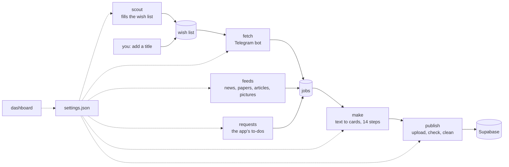

# Content pipeline: design (version 2)

**Status:** implementation started, 2026-11-12. Pipeline ticket 01 built settings, the local store, model drivers and diagnostic commands. Ticket 02 built the method as code (`text.py`, `gates.py`, `cardmaker.py`) with the `add` and `gates` commands; the clock and the stages come with ticket 04. The source catalogue is in `docs/CONTENT_SOURCES.md`, and the card-making method with its prompts is in `tools/content/cardmaker/`. Section 16 lists what was really tested and what was not.

Ticket 05 (done 2026-11-15) adds `telegram login`/`probe`, the `fetch` stage, the inbox folder and the Saved Messages notices; section 7.2 now describes what the real bot does.

Ticket 06 adds thirteen public-source readers, licensed feed intake, link intake, image cards, `licenses`, and the Sources controls. Currents is included as well after validation; see the dated catalogue observations.

Ticket 07 adds `scout.py`, `topic_subjects.json`, the Open Library admission door, the four-source wish-list gatherer (with daily subject rotation and topic balance), `want`, and the Books page "Add" control.

Ticket 04 (2026-11-14) adds the clock, verified publishing and cleanup, single-trial removal and the local ten-page dashboard. Input stages remain unbuilt until tickets 05–08; no scheduled task is installed.

**How to use this document.** It is the source of truth for the build tickets (section 17). A ticket may not change a contract written here (file shapes, setting names, stage rules). If something here turns out to be wrong, the agent fixes this document in the same commit and says why.

## 1. In one paragraph

A small program on your PC wakes up every 10 minutes and looks at one settings file. That file says which **stages** are switched on, how often each one works, and which **model provider** does each job. One stage keeps a wish list of books filled. One opens the chat with your Book Downloader bot on Telegram, types the next title, picks the best edition and downloads it. One fetches free sources from the internet: news, papers, articles, pictures. One turns each text into cards and tests with the method in `tools/content/cardmaker/`. One uploads the result with the existing `upload.py`, checks it arrived, and deletes the book from the PC. A local web page (the dashboard) shows all of it and edits the settings file. Every model job can be given to any provider (a subscription program, a paid or free API, OpenRouter, a model running on your PC) by changing one line.

**No database change is needed.** The pipeline writes only what `upload.py` already writes and reads the existing `content_requests` table.

## 2. What changed from version 1

| Version 1 | Version 2 |
|---|---|
| You send book files to a bot you own | The pipeline keeps a wish list and asks the Book Downloader bot itself, signed in as you |
| One loop does everything | Six stages, each with its own schedule and its own providers |
| Three fixed model runners | Any provider through two drivers (a command-line program, or an OpenAI-style web address) |
| Settings in several files, control through Telegram | One settings file and a local dashboard |
| One prompt reads, one writes, one checks | A 14-step method with evidence checks, a judge and a blind solver, kept as a skill |
| News only from Wikipedia | A checked list of free news sources (section 8 and `docs/CONTENT_SOURCES.md`) |
| The job folder is the master copy | The database is the master copy; the PC keeps nothing but a small report |

## 3. Goals and limits

Goals
- No manual step from "a title is on the list" to "cards are in the app".
- Every piece can be swapped by editing settings: the provider of a job, the schedule of a stage, the whole stage.
- Cards that are true to the source, complete, and clear alone. A doubtful card is dropped, never patched.
- Restartable: any stage can stop at any moment (limit reached, crash, PC off) and continue later.
- Safe: never delete real content, never commit a book, never let book text or a web page run commands.

Limits
- No change to the app, the database tables or what `upload.py` does.
- English sources only (D38). No OCR, no made-up pictures, audio or video.
- No server in the cloud. Everything runs on your PC.

## 4. The big picture



The six stages

| Stage | Job | Uses a model for | Default schedule |
|---|---|---|---|
| `scout` | add good book titles to the wish list | suggesting titles (optional) | once a day |
| `fetch` | get the next wanted book from the Telegram bot | choosing the edition, only when the rules cannot | every 2 hours, 1 book per run |
| `feeds` | fetch free sources (news, papers, articles, pictures) | nothing | 3 times a day |
| `make` | turn a text into cards and tests | every step of the method | every 30 minutes |
| `publish` | upload, check, delete local files | nothing | every 30 minutes |
| `requests` | answer the app's to-dos (more cards, more tests, problems) | writing and judging | twice a day |

**A stage is a contract, not a program.** Each stage reads rows and files in a known shape and writes rows and files in a known shape (section 7 for each). The built-in code is one way to honour the contract. In the settings a stage may point to any other command instead (`"run": [...]`), for example an agent CLI of another vendor. As long as it leaves the same files and rows behind, nothing else notices.

## 5. Where it runs and what it keeps

### 5.1 One clock

Windows Task Scheduler starts one command every 10 minutes. That command does all the timing itself from the settings file, so you never touch Task Scheduler again.

```powershell
schtasks --% /Create /TN "SmartScrolling pipeline" /SC MINUTE /MO 10 /F /IT /TR "wscript.exe \"<path-to-repo>\tools\content\pipeline\tick.vbs\""
```

Pipeline ticket 04 creates two small files next to the code. `tick.cmd` goes to the project folder (`cd /d "%~dp0..\..\.."`) and runs `py -3 -m tools.content.pipeline tick`. `tick.vbs` starts `tick.cmd` without a window, so no black box flashes on your screen every 10 minutes. The program writes its own log, one file per day in `logs/` of the pipeline\'s home, so nothing depends on where the home folder is. In Task Scheduler\'s window, tick "Run task as soon as possible after a scheduled start is missed".

**Create this task only when the stages you want are built** (it is the last owner step). The task runs whatever code is in the project folder against the real database, so it must not run while an agent is halfway through a stage. Until then the pipeline is run by hand: `pipeline tick`, `pipeline run <stage>`, or "Run now" on the dashboard. A stage whose code does not exist yet is skipped by `tick` with the result `nothing` and the summary "not built".

`tick` does this, in order:
1. Read the settings (5.3). If `paused` is true, stop.
2. Take the lock `state/tick.lock` (it holds the process id; a lock whose process is gone is stale). If another tick is running, stop.
3. For each stage in the order `publish`, `make`, `requests`, `fetch`, `feeds`, `scout`: run it if it is enabled, due and inside its allowed hours. A stage is due when `now - last finished run >= every_minutes`. `publish` and `make` come first so that finished work leaves the PC before new work arrives.
4. Stop starting stages when `tick.max_minutes` have passed. A stage also has its own `max_minutes` and checks it between items.
5. Write one row per stage run in the `runs` table.

The vendors' own schedulers (Claude scheduled tasks, Gemini scheduled actions, Codex automations) are not used as the clock. They each time only their own model, the cloud ones cannot see files on your PC, and you would have three places to change a schedule. If you ever want one of them to do a stage, it can call `py -3 -m tools.content.pipeline run <stage>`; the lock and the contracts still apply.

TLS uses Python's normal certificate verification, with no custom bundle or environment setting. On 2026-11-16 an expired cross-signed ISRG Root X2 intermediate in `Cert:\CurrentUser\CA` was backed up and removed from this PC's cache (thumbprint `151682F5218C0A511C28F4060A73B9CA78CE9A53`, expired 2025-09-15). OpenSSL had preferred that cached intermediate over the valid chain supplied by the server. The ignored backup is `backups/tls-2026-11-16/expired-isrg-root-x2-cross-signed.cer`. Trusted roots were unchanged. Public endpoints now verify without `SSL_CERT_FILE`, while expired, self-signed and wrong-host certificates are still refused. No scheduled task is installed by ticket 06.

### 5.2 The pipeline's home

Everything the pipeline keeps is in one folder outside the repository, so a book can never be committed: `PIPELINE_HOME`, default `%USERPROFILE%\SmartScrollingContent`. It is read from the environment variable `PIPELINE_HOME` first, then from `.env`, then the default. Tests and every trial run of a ticket set the environment variable to a temporary folder, so they never touch your real lists.

```
SmartScrollingContent/
├── settings.json          your choices (5.3); the dashboard edits this file
├── pipeline.db            lists and history (SQLite, part of Python)
├── qualified.json         which provider passed the exam for which role (9.5)
├── telegram.session       your Telegram login for the fetch stage (as secret as a password)
├── state/                 lock files, resting.json
├── inbox/                 book files you drop in yourself (7.3)
├── probe/                 saved answers of the Telegram bot (7.2)
├── sandbox/               an empty folder the model programs are started in
├── jobs/<job id>/         working files of a source that is being made (deleted after upload)
├── archive/<source id>/   what stays after upload: report.json, brief.json, ideas.json (small)
└── logs/                  one text file per day
```

`pipeline.db` tables (created by the program on first start; this is not the app's database)

| Table | One row is | Columns |
|---|---|---|
| `books` | a title on the wish list | `id`, `title`, `authors` (JSON list), `year`, `isbn13`, `ol_work`, `topics` (JSON list), `origin`, `score`, `priority`, `status`, `attempts`, `next_try_at`, `last_error`, `job_id`, `added_at`, `updated_at` |
| `jobs` | a source being made | `id` (the source id), `kind`, `title`, `origin`, `status`, `step`, `attempts`, `error`, `counts` (JSON), `created_at`, `updated_at` |
| `seen` | something already taken, so it is not taken twice | `key` (a feed item id, a link, or the SHA-256 of a file), `job_id`, `at` |
| `runs` | one run of one stage | `id`, `stage`, `started_at`, `ended_at`, `result` (`ok`, `nothing`, `stopped`, `failed`), `summary` |
| `calls` | one model call | `at`, `provider`, `role`, `job_id`, `ok`, `error_kind`, `seconds`, `tokens_in`, `tokens_out` |

Status words
- `books.status`: `wanted` → `searching` → `downloaded`, or `not_found`, `failed`, `skipped` (you skipped it), `duplicate`.
- `jobs.status`: `queued` → `making` → `ready` → `uploaded` → `done`; or `waiting` (all providers of a role are resting), `review` (too few cards passed; needs your eyes), `failed`.

### 5.3 One settings file

Settings are `tools/content/pipeline/defaults.json` (committed; the defaults below) with `PIPELINE_HOME/settings.json` laid over it key by key. Your file holds only what you changed. Every stage reads the settings at its start, so a change needs no restart. Secrets are never in either file: they stay in the root `.env` (section 13).

The complete default settings:

```json
{
  "paused": false,
  "trial": false,
  "tick": {"max_minutes": 9},
  "stages": {
    "scout":    {"enabled": true,  "every_minutes": 1440, "hours": [8, 23], "max_minutes": 5,  "run": "builtin"},
    "fetch":    {"enabled": true,  "every_minutes": 120,  "hours": [8, 23], "max_minutes": 8,  "run": "builtin", "per_run": 1},
    "feeds":    {"enabled": true,  "every_minutes": 480,  "hours": [0, 24], "max_minutes": 5,  "run": "builtin"},
    "make":     {"enabled": true,  "every_minutes": 30,   "hours": [0, 24], "max_minutes": 25, "run": "builtin"},
    "publish":  {"enabled": true,  "every_minutes": 30,   "hours": [0, 24], "max_minutes": 5,  "run": "builtin"},
    "requests": {"enabled": true,  "every_minutes": 720,  "hours": [0, 24], "max_minutes": 10, "run": "builtin"}
  },
  "providers": {
    "claude-haiku":  {"driver": "cli", "preset": "claude", "model": "haiku",  "family": "anthropic", "max_calls_per_day": 400},
    "claude-sonnet": {"driver": "cli", "preset": "claude", "model": "sonnet", "family": "anthropic", "max_calls_per_day": 100},
    "codex":         {"driver": "cli", "preset": "codex",  "model": "gpt-6-luna",       "family": "openai",    "max_calls_per_day": 100, "enabled": false},
    "gemini-cli":    {"driver": "cli", "preset": "agy",    "model": "gemini-3.8-flash-medium", "program": "%USERPROFILE%/.gemini/bin/agy.exe", "tools": "on",       "family": "google",    "max_calls_per_day": 300, "enabled": false},
    "gemini-api":    {"driver": "openai", "base_url": "https://generativelanguage.googleapis.com/v1beta/openai", "key_env": "GEMINI_API_KEY", "model": "", "json": "schema", "family": "google", "max_calls_per_day": 200, "enabled": false},
    "openrouter":    {"driver": "openai", "base_url": "https://openrouter.ai/api/v1", "key_env": "OPENROUTER_API_KEY", "model": "", "json": "schema", "extra_body": {"provider": {"require_parameters": true}}, "family": "other", "max_calls_per_day": 50, "enabled": false},
    "local":         {"driver": "openai", "base_url": "http://localhost:11434/v1", "key_env": "", "model": "", "json": "schema", "family": "local", "max_calls_per_day": 100000, "enabled": false}
  },
  "roles": {
    "scout":     ["claude-haiku"],
    "choose":    ["claude-haiku"],
    "summarize": ["claude-haiku"],
    "brief":     ["claude-haiku"],
    "extract":   ["claude-haiku"],
    "select":    ["claude-haiku"],
    "write":     ["claude-haiku"],
    "judge":     ["claude-sonnet", "claude-haiku"],
    "quiz":      ["claude-haiku"],
    "solve":     ["claude-haiku"]
  },
  "wishlist": {
    "target_wanted": 30,
    "topic_balance": true,
    "year_from": 1950,
    "sources": {
      "owner": true,
      "openlibrary_trending": true,
      "openlibrary_subjects": true,
      "prize_pages": true,
      "nyt_lists": false,
      "model_suggestions": true
    },
    "model_suggestions_per_run": 10
  },
  "fetch": {
    "driver": "telegram",
    "bot": "",
    "query": "{title} {author_surname}",
    "formats": ["epub", "azw3", "mobi", "fb2", "pdf"],
    "max_mb": 80,
    "reply_wait_seconds": 90,
    "quiet_seconds": 6,
    "max_hops": 4,
    "pause_seconds": [5, 20],
    "max_attempts": 3,
    "retry_after_days": 7,
    "stop_words": ["captcha", "subscribe", "join", "limit", "banned"]
  },
  "feeds": [],
  "licenses": {"allow_noncommercial": true},
  "make": {
    "chunk_words": [1500, 3000],
    "ideas_per_chunk": 6,
    "cards": {"book": {"per_words": 2500, "min": 10, "max": 60}, "article": {"per_words": 500, "min": 2, "max": 8}, "paper": {"min": 1, "max": 2}, "news": {"min": 1, "max": 2}},
    "tests_per_card": 3,
    "batch": {"write": 4, "judge": 4, "quiz": 3, "solve": 3},
    "call_timeout_seconds": 300
  },
  "quality": {
    "require_qualified": true,
    "judge_differs_from_writer": true,
    "tools_on_source_text": false,
    "min_pass_rate": 0.6,
    "min_cards": {"book": 8, "article": 2, "paper": 1, "news": 1}
  },
  "publish": {"auto_publish": false, "store_original": true, "store_text": true, "keep_archive": true},
  "notify": {"telegram_saved_messages": true},
  "dashboard": {"port": 8765},
  "contact_email_env": "CONTACT_EMAIL"
}
```

Rules for the settings
- An unknown key is an error with the key's name, not silently ignored (a typo must not switch something off quietly).
- `trial` is for testing only and is never true in your real settings. While it is true, every job a stage creates is a sample job, exactly as if it had been added with `add --sample` (10.4).
- `every_minutes` is the only timing unit. The dashboard shows and edits it as "every 2 hours" or "12 times a day".
- `hours: [8, 23]` means the stage may start from 08:00 up to 22:59, local time.
- A stage whose one-time setup is missing does nothing and says so on the Overview page (for `fetch`: "sign in to Telegram", section 14). The `feeds` list is filled from `docs/CONTENT_SOURCES.md` by pipeline ticket 06.
- A provider may name its `program` (a full path) when the program is not on the PATH, and `"tools": "on"` when its tools cannot be switched off (9.4).
- A provider with an empty `model` cannot be used; the dashboard shows it as "needs a model". New providers may omit optional fields: `enabled` defaults to true and `max_calls_per_day` to 100; a model must still be supplied before role calls can use it. Known settings reject values of the wrong JSON type; roles reject unknown provider names.

### 5.4 The dashboard

Yes, a local dashboard is possible and it is the right face for this: the settings file stays the single truth, and the dashboard is only a page that reads and writes it. Everything the dashboard can do, a command or a text editor can do too, so nothing depends on it.

Why not something else
- **Only the settings file**: works, and stays supported, but you asked to change many things often; a page with switches is faster and shows what is happening.
- **A Telegram control bot**: good for a phone, weak for tables and long card texts. The pipeline still sends you a short message when something needs you.
- **A screen inside the app**: would need new tables and admin rights in the app; the tables are frozen.
- **A ready-made workflow tool (n8n, Airflow)**: a second system to install, learn and keep alive for six small stages.

How it is built: `py -3 -m tools.content.pipeline dashboard` starts a small web server from Python's standard library on `http://127.0.0.1:8765` and serves one HTML file with plain JavaScript. No framework, no build step.

Pages

| Page | Shows | Lets you change |
|---|---|---|
| Overview | each stage: on or off, last run, result, next run; books waiting; jobs in work; anything that needs you | pause everything; switch a stage; "Run now" |
| Schedule | per stage: how often, allowed hours, how many per run | all of them |
| Providers | each provider: driver, model, enabled, calls today against its cap, resting until, exam result per role | enable, model, daily cap; "Test" (one tiny call); "Run exam" |
| Roles | each role and its ordered provider list | the order and the members |
| Books | the wish list with status, origin and error | add a title, move up or down, skip, retry |
| Sources | feeds with on/off, how many per day, topics; counts taken | all of them |
| Jobs | each source in work: step, counts, dropped cards with the reason | retry, drop |
| Review | sources uploaded as draft: every card and test, as text | publish, hide; switch "publish automatically" |
| Usage | calls and tokens per provider per day (14 days) | nothing |
| Log | today's log lines | nothing |

Safety of the dashboard
- It listens only on `127.0.0.1`. It refuses a request whose `Host` is not `127.0.0.1:<port>` or `localhost:<port>`.
- Every change needs a random token that the server makes at start and puts into the page it serves. This stops another website open in your browser from changing your settings.
- It never shows a secret. For each key in `.env` it shows only "set" or "missing".

Server addresses (all JSON): `GET /api/state`, `GET /api/settings`, `POST /api/settings` (the changed keys only; validated with the same rules as the file), `GET /api/books`, `POST /api/books`, `GET /api/jobs`, `GET /api/job?id=`, `POST /api/job`, `GET /api/review?id=`, `POST /api/publish`, `POST /api/run`, `POST /api/provider-test`, `GET /api/usage`, `GET /api/log`.

Commands (the same things without the page)

```
py -3 -m tools.content.pipeline tick                       what Task Scheduler runs
py -3 -m tools.content.pipeline run <stage>                run one stage now
py -3 -m tools.content.pipeline status                     the Overview page as text
py -3 -m tools.content.pipeline want "Title" --author "Name"   add a book
py -3 -m tools.content.pipeline add <file or link> [--sample] [--max-chunks N]   make a source from a file you have or a web page
py -3 -m tools.content.pipeline set stages.fetch.every_minutes 60
py -3 -m tools.content.pipeline provider-test <name>
py -3 -m tools.content.pipeline eval --provider <name>     the exam (9.5)
py -3 -m tools.content.pipeline gates <folder>             run the code gates on a folder made by hand
py -3 -m tools.content.pipeline telegram login [--qr] | probe "<title>" | probe --press <probe> <option>
py -3 -m tools.content.pipeline licenses                   list the sources by license (to review before sharing the app)
py -3 -m tools.content.pipeline remove-trial <source id>   delete one trial source (id starts with trial-, is_sample true)
py -3 -m tools.content.pipeline dashboard
```

## 6. The wish list (stage `scout`)

The wish list is the `books` table. `scout` keeps `wishlist.target_wanted` titles in status `wanted`. If there are already that many, it does nothing.

Where titles come from (each can be switched off)

| Source | What it gives | How |
|---|---|---|
| `owner` | titles you add | dashboard, or the `want` command. They get `priority` 1 and go first. |
| `openlibrary_trending` | what many people read now | `https://openlibrary.org/trending/monthly.json?limit=50` |
| `openlibrary_subjects` | well-known books of a subject | `https://openlibrary.org/subjects/<subject>.json?limit=50`, for the subjects mapped to each topic (below) |
| `prize_pages` | winners of non-fiction prizes | the prize's list page on Wikipedia, read for titles and authors; the pages are listed in `docs/CONTENT_SOURCES.md` |
| `nyt_lists` | current best-sellers | New York Times Books API, needs a free key; off by default |
| `model_suggestions` | notable books for the topics with the fewest sources | role `scout`: one call that returns up to 10 `{title, author}` |

The topic-to-subject map is the file `tools/content/pipeline/topic_subjects.json`: for each topic id in `tools/content/topics.json`, a list of Open Library subject names. A topic missing from the map gets no subject search (the Overview page says so).

Every candidate, wherever it comes from, goes through the same door:
1. **It must exist.** Search Open Library: `https://openlibrary.org/search.json?title=<t>&author=<a>&fields=key,title,author_name,first_publish_year,isbn,subject,language,readinglog_count,ratings_average&limit=5`. Keep the first result whose title and first author match the candidate after normalising (lowercase, no accents, no punctuation, subtitle after `:` dropped). No match: the candidate is thrown away. This is what stops a model from inventing a book.
2. **It must fit.** English available, `first_publish_year >= wishlist.year_from`, and no subject containing "fiction" (as a whole word, except "non-fiction"/"nonfiction"), "novel", "poetry", "juvenile".
3. **It must be new.** Not already in `books` (same `ol_work`, or same normalised title and author surname), and not already a source in the app's database (same normalised title).
4. **It gets a score**: `readinglog_count` (how many people shelved it), plus a bonus for a prize, plus a bonus when its topic has few sources (`topic_balance`). Higher scores are added first.

A row is added with `status = wanted`, `origin` = the source name, `topics` = the topic ids it was found under.

Contract of the stage: reads the settings, `books`, the app's `sources` titles. Writes new `books` rows. Never changes a row that is not `wanted`.

## 7. Getting the book (stage `fetch`)

### 7.1 How a program talks to your bot

Book Downloader is someone else's bot. A bot of your own cannot do this job: Telegram lets two bots write to each other only when both owners switch that on. So the pipeline signs in **as you**, with your own Telegram account, exactly as the Telegram app on your PC does. It uses Telegram's official interface for apps and the free library Telethon (version 1.x; with `qrcode` for the QR sign-in, these are the only extra Python packages of the whole pipeline, used only by this stage).

- You create an "app id" once at `my.telegram.org` and sign in once with the code Telegram sends you (section 14), or, when the code does not arrive, with `telegram login --qr`: a QR code on a local page that the phone scans under Settings → Devices → Link Desktop Device. The login is stored in `PIPELINE_HOME/telegram.session`.
- That file is as powerful as your password. It stays in `PIPELINE_HOME`, is never committed, never uploaded, never shown.
- The program touches one chat only: the bot named in `fetch.bot`. It also writes to your own "Saved Messages" for notices.

**Code does the talking; a model only chooses.** Typing a title, waiting, pressing a button and saving a file are fixed steps, so code does them: it is free, fast and always the same. The one real decision, which edition is the right one, goes to the `choose` role when the rules cannot decide. To give this stage to another vendor you change `roles.choose`. If you would rather have a whole agent of another vendor drive Telegram, set `stages.fetch.run` to that agent's command; it must honour the contract at the end of this section.

### 7.2 The steps

For each run, up to `stages.fetch.per_run` books:

1. **Take a book.** The `wanted` row with the lowest `priority`, then the highest `score`, then the oldest, whose `next_try_at` is empty or past. Set it to `searching`.
2. **Ask.** Send `fetch.query` filled in (default: title and the first author's surname) to the bot.
3. **Listen.** Collect every message the bot sends, and every edit of those messages, until nothing changes for `quiet_seconds`, or `reply_wait_seconds` pass. After a hop that chose a book, if the answer holds no file yet, listen once more without sending anything: the file can come a little after the book's details.
4. **List the options.** Turn everything collected into one flat list. An option has a `label` (the words a person would read) and a way to take it:
   - a button that sends a click (`callback`);
   - a button that opens a web address (`url`), or a link in the text that is a Telegram link or ends in a book format; a link to a web page ("visit our website", a book's page) is not an option;
   - a command in the text such as `/book_aY5jJKx47vp` (`command`); its label is the paragraph it stands in (the text between blank lines), because a list of books puts title, author, year and format on separate lines. A link in the same paragraph as a command is left out: the command is the bot's own way to the same book;
   - a file attached to a message (`document`); its label is the file name plus the caption.
   Buttons that only turn pages ("Next", "›", "2/5", "(2) next »", "- 1 -") are kept aside as `nav`.
5. **Filter by rules.** From each label read the format (epub, pdf…), the size, and the title words. Drop options whose format is not in `fetch.formats`, whose size is over `max_mb`, or that share less than half of the title's words. Order the rest by the position of their format in `fetch.formats`, then by how many title and author words they contain. After a hop that chose a book, the next labels ("EPUB", a file name) need not repeat the title: only the format counts.
6. **Choose.**
   - No option left: if there is a `nav` button and hops remain, press it and go to 3. Otherwise the book is `not_found`.
   - One option left, or the first is ahead of the second on both format and words: take it.
   - Otherwise ask the `choose` role: it gets the book (title, authors, year) and the numbered labels, and returns `{"index": <number>, "reason": "<one sentence>"}`, with `-1` for "none of these is this book".
7. **Take it.**
   - `callback`: press the button, then go to 3 (one hop).
   - `command`: send it, then go to 3 (one hop).
   - `document`: download it from Telegram.
   - `url`: if it points to `t.me`, open it as Telegram would (a bot start link is sent as `/start <code>`, then go to 3). Any other address is downloaded over HTTPS or HTTP with at most 5 redirects, stopping above `max_mb`.
   At most `max_hops` hops per book. Wait a random `pause_seconds` between any two messages you send.
8. **Check the file.** It must be at least 20 KB and start like the format it claims: an EPUB is a zip whose `mimetype` entry says `application/epub+zip`; a PDF starts with `%PDF`; MOBI and AZW3 hold `BOOKMOBI` at byte 60; FB2 starts with `<?xml` and contains `<FictionBook`. Anything else is deleted at once. The file is never opened with the shell and never run. If its SHA-256 is already in `seen`, the book is `duplicate`.
9. **Hand over.** Create the job folder with `original.<ext>` and `meta.json` (title, authors, year, isbn, topics from the `books` row), add a `jobs` row with status `queued`, set the book to `downloaded`.
10. **Check it is the right book** (done by `make` after it has the text): the title words and the author's surname must appear in the first 3,000 words or in the file's own metadata. If not, the job is dropped, the book goes back to `wanted` with `attempts + 1`, and the option that was taken is remembered in `last_error` so it is not taken again.

When it does not work

| What happens | What the stage does |
|---|---|
| the bot does not answer, or sends no file for the book it was asked for | `attempts + 1`, try again tomorrow |
| nothing matches | `not_found`; tried again after `retry_after_days`, up to `max_attempts`, then left for you |
| Telegram says "slow down" (flood wait) | the stage rests until the time Telegram gives; nothing is retried before |
| the bot asks for something code cannot do (join a channel, solve a puzzle, a daily limit) | the stage switches itself off and tells you. It never tries to get around a puzzle or a limit. Recognised by the words in `fetch.stop_words`, looked for in a reply that offers no option, and in the answer to a chosen book that brings no file |
| the file fails the check | deleted; the next option is tried once; then `failed` |

**What the bot does** (probed against saved fixtures in `tools/content/pipeline/testdata/probes/`). It represents a typical Telegram book-search bot.
- A title gets one message: "Good news! We found 320 📚 on your request:", then five books, one paragraph each: `📚 TITLE` (capitals, long ones cut with "..."), the authors, `Year: 2001`, `🌐 English`, and `/book_<code> (epub, 4.82 MB) ↗️`. The command takes the book; the ↗️ link goes to the book's web page (never saved in test files). Some answers end with a "Hint … visit Example Library website" link.
- Pages: two buttons under the message, "- 1 -" (the page you are on) and "(2) next »". Pressing "next" edits the same message to the next five books, with "« prev (1)" added.
- Nothing found: "Unfortunately, nothing has been found on your request 🙁", a hint, and no buttons.
- Sending a book's command brings two messages: the book's details with one button, "Click to read full description", and then the file itself, attached, named like `The_Problems_of_Philosophy_Bertrand_example.epub`. So a book is one hop away: search, send the command, download the attached file.

### 7.3 Contract of the stage

Reads: one `books` row with status `wanted`. Writes: either a job folder with `original.<ext>` (one of `fetch.formats`, passing the check in step 8) and `meta.json`, a `jobs` row `queued`, a `seen` row, and the book `downloaded`; or the book in `not_found` or `failed` with `last_error`, or back in `wanted` with a later `next_try_at`.

Other ways to honour the same contract
- **A folder you drop files into**: `PIPELINE_HOME/inbox/`. Every book file found there becomes a job (title and author from the file itself). Always on; this is how books you bought and files you already have come in.
- **Free book sites**: Project Gutenberg and Standard Ebooks, through `feeds` (section 8).
- **`"driver": "command"`**: any program of yours; it gets the title and author as arguments and must leave the file and `meta.json` in the folder named by the `JOB_DIR` environment variable.

### 7.4 Two things to know about this stage

- **Your account.** Automating your own account is allowed by Telegram's rules for apps, but accounts that send many messages fast get limited. The defaults (one book every 2 hours, pauses of 5 to 20 seconds) are far below anything unusual. Do not lower them much.
- **The session file** is a full login. If the PC is lost, end that session from Telegram → Settings → Devices.

## 8. Free sources (stage `feeds`)

`docs/CONTENT_SOURCES.md` is the catalogue: every source with its address, its license, what was checked and when. This section is the design.

A **reader** is a small function for one site. Every reader returns the same thing, a list of items:

```json
{"key": "arxiv:2611.13758", "kind": "paper", "title": "…", "authors": ["…"], "published_on": "2026-11-10",
 "link": "https://…", "license": "CC0", "credit": "arXiv", "text": "plain text, paragraphs separated by a blank line",
 "details": {"doi": "…", "journal": "arXiv", "paper_status": "preprint"}, "topics": ["artificial-intelligence"],
 "media": null}
```

`kind` is `book`, `paper`, `news` or `other`. For news, `details` holds `{"newspaper": "…", "show_until": "<date + 30 days>"}`. For a picture, `media` holds `{"file": "<downloaded picture>", "alt_source": "<the collection's own description>"}`.

A feed is one line in the settings: `{"reader": "arxiv", "params": {"query": "cat:cs.AI"}, "topics": ["artificial-intelligence"], "per_day": 2, "enabled": true}`.

The stage, for each enabled feed: call the reader; drop items whose `key` is in `seen`; drop items whose `license` is not allowed (below); take up to `per_day` minus what this feed already gave today; for each, make a job folder with `text.txt` and `meta.json`, a `jobs` row `queued` and a `seen` row. A reader that fails skips its feed for this run and writes the error to `runs`; three failures in a row show on the Overview page.

Implementation: `readers.py` handles bounded requests and parsers, `licenses.py` holds the allowlist and trailing attribution, and `feeds.py` queues ordinary jobs. Feed identity is a hash of reader, parameters and topics; `jobs.origin` keeps it after publication for daily/total counts. Changing only enabled/per_day preserves those counts. `state/feeds.json` keeps the last error and consecutive failures; requests inherit the stage deadline. Search readers skip seen candidates before downloading. Gutenberg supplies an EPUB instead of `text.txt`; image jobs additionally keep their checked picture. Normal text responses are limited to 5 MB/30 seconds, images and EPUBs to 50 MB, and the separately cached weekly Gutenberg catalogue to 30 MB (the observed catalogue is 21 MB).

`add <link> [--sample] [--license "<name>"]` routes Wikipedia, arXiv, Europe PMC (PMCID or source/id) and Gutenberg addresses through their readers. Other HTTP(S) pages are fetched once as `other` with unknown license, and refused until an explicit allowed license is supplied. `pipeline licenses` lists every source's id, kind, trailing license and non-commercial flag through the existing upload client. Unknown descriptions stay unknown. Sources controls use `GET /api/feeds` and the existing validated settings endpoint.

License rule (code, not judgement)

| License of the item | Used | Note |
|---|---|---|
| public domain, CC0 | yes | credit kept anyway |
| CC BY, CC BY-SA | yes | the source `description` ends with the credit, for example "Adapted from Wikipedia, CC BY-SA 4.0." |
| CC BY-NC, CC BY-NC-SA | only while `licenses.allow_noncommercial` is true (default true: the app is private) | listed by `pipeline licenses`, to review before the app is ever shared widely |
| any "ND" (no derivatives), "all rights reserved", unknown | no | a card is a new work made from the text, which ND forbids |

NewsData is a narrow additional intake permission, labelled `NewsData.io personal/internal use`, never relabelled as Creative Commons. It follows `allow_noncommercial`, processes only headline/description facts and keeps publisher/link plus the service credit. The terms leave publisher rights with their owners. Every admitted source, including public-domain material, ends its description with its provenance and normalized license; the NewsData sentence remains last.

Currents is included under explicit authorization obtained by the owner, labelled `Currents authorized use` rather than a Creative Commons license, and follows `allow_noncommercial`. It retains the original link and Currents credit, uses headline/description facts only, and skips items under 40 words. Its API names the journalist but has no publisher field, so `newspaper` uses the original URL's hostname. The default technology feed maps to `technology-policy`; as with NewsData, service categories can be inaccurate and final topics are checked by the card method. Commercialization or wider distribution is outside this authorization.

### News

The rule that makes news possible: **facts are free, wording is not.** A news card states what happened in the pipeline's own words, names the publisher and links to the original. Only the source's facts are used, never its sentences (the "12 words in a row" gate enforces it). So what matters about a news source is whether the pipeline may *fetch and process* its text.

| Group | Sources | Why they are safe to fetch | Default |
|---|---|---|---|
| Open text | Wikipedia "Current events" (one page per day) and the "In the news" part of the daily featured feed | CC BY-SA; made to be reused | on |
| Public bodies | NASA news releases, European Commission press corner, Voice of America, other US agency newsrooms | public domain or CC BY 4.0 | on |
| Open newsrooms | Global Voices | CC BY | on |
| News service with a free key | NewsData.io | its API terms allow personal/internal use; publisher rights remain separate; only headline/description facts are processed | on once you add the key |
| Authorized news service | Currents | included under explicit authorization obtained by the owner; publisher links and service credit retained | on once you add the key |
| Not used | The Guardian Open Platform (its terms forbid AI use and keeping text over 24 hours), NewsAPI.org (free plan forbids real use), New York Times, ANSA (forbid reuse and AI processing), The Conversation and ProPublica (no-derivatives licenses), Wikinews (closed in 2026), GDELT and Hacker News (links only, no text to summarise) | | |

**What the free news services give.** Their free plans return the headline, one to three sentences of description, the publisher and the link; the full article is in the paid plans everywhere. That is enough for one short card: the card says only what the headline and the description say (the gates check its numbers and names against them), names the publisher and links to the article. An item with fewer than 40 words of headline plus description is skipped. NewsData.io asks for a credit, so the source `description` ends with "News data by NewsData.io." The other services (GNews, TheNewsAPI, World News API, mediastack, Webz.io) are smaller or stricter; they are listed in `docs/CONTENT_SOURCES.md` and can be added as readers the same way.

A news item becomes a `news` source with usually one card. `show_until` is 30 days after the event, after which its cards leave Discover but stay in people's Library (CONTENT_FORMAT).

For news, extract/select target the event named in the title; linked encyclopedia leads are supporting background, not separate news. Intake adds the reader's absolute publication date to the evidence so dates pass the same factual gates, and writing avoids unanchored "today"/"yesterday". The judge measures timely significance over the 30-day display period instead of demanding a fact worth remembering a year later. Paper selection admits research findings and enforces `research` format. Picture writing uses the collection description and the `image` prompt/schema, then the ordinary gates, judge, repairs, quiz and blind solver; recognising the pictured work is sufficient value, while unsupported visual details are still rejected. A picture is copied before its job becomes queued; downloaded book/picture input copies in `state` are removed after handoff so publishing does not leave an extra original behind.

### Books, papers, articles and pictures

- **Free books**: Project Gutenberg (public domain) and Standard Ebooks (CC0). They enter as jobs like any other book.
- **Papers**: arXiv (abstracts; metadata is CC0), Europe PMC open-access subset (full text, license per paper), Hugging Face daily papers (as a "what is notable today" list that points to arXiv). A paper becomes a `paper` source with 1 or 2 `research` cards.
- **Articles**: Wikipedia (any article; the list of "vital articles" is the wish list for it), Our World in Data (CC BY). A `kind: other` source.
- **Pictures**: The Met, Art Institute of Chicago, NASA picture of the day, Wikimedia Commons (license read per file). One `image` card each; the card text is written from the collection's own description, and `media_alt` describes the picture.

## 9. Models: any provider, swappable

### 9.1 Words

- A **provider** is one way to reach one model: a name, a driver, a model id and a few fields.
- A **role** is one kind of job a model does (`extract`, `write`, `judge`…). Each role has an ordered list of providers. The first one that is enabled, qualified, under its daily cap and not resting does the job.
- A **driver** is the code that talks to a provider. There are exactly two.

Swapping means editing `roles` (who does what) or `providers` (how one is reached). Nothing else in the pipeline knows which model answered.

**Every model job in the pipeline is a role, so every step can have its own provider.** There are ten:

| Role | Stage | The job |
|---|---|---|
| `scout` | scout | suggest book titles for thin topics |
| `choose` | fetch | pick the right edition among the bot's options |
| `summarize` | make | notes on one chunk |
| `brief` | make | the one-page guide to the whole text |
| `extract` | make | find the ideas in one chunk, with evidence |
| `select` | make | choose which ideas become cards |
| `write` | make | write the cards (and repair them) |
| `judge` | make, requests | check each card against the text |
| `quiz` | make, requests | write the tests |
| `solve` | make | answer the tests blind |

How you change who does what
- **On the dashboard**, page Roles: one row per role, a drop-down per place in its list. Saved at once; the next call uses it.
- **By command**: `py -3 -m tools.content.pipeline set roles.judge gemini-cli,claude-sonnet`.
- **In the file**: the `roles` block of `settings.json`.

Examples
- "Gemini judges, Claude writes": `roles.judge = ["gemini-cli", "claude-sonnet"]`.
- "A local model does the cheap reading, Claude the writing": `roles.summarize = ["local", "claude-haiku"]`.
- "Try an OpenRouter model as writer": add its model id to the `openrouter` provider, run its exam, then `roles.write = ["openrouter", "claude-haiku"]`.
- "Claude ran out for today": nothing to do. Each list is a fallback order, so the next provider takes over by itself.

A list is an order of preference, not a team: the first provider that is enabled, has passed the exam for that role, is under its daily cap and is not resting does the job.

### 9.2 How a subscription is used (this is the part that differs from an API)

With an API you hold a key and your program sends a web request. A subscription has no key you may use that way. What a subscription gives you is the right to use the vendor's **own programs**. Each vendor ships one that works in a terminal (Claude Code, Codex, Google's Antigravity CLI). You sign in to it once in your browser, and it keeps that login on your PC.

Those programs have a "no window" mode: you start them with a prompt, they print the answer and stop. So the pipeline does exactly what you would do by hand:

1. it starts the vendor's program (for example `claude -p`);
2. it hands it the prompt on standard input, the way a pipe does;
3. it reads the printed answer;
4. the program ends.

The call uses your subscription's normal allowance, the same as if you had typed the prompt. No key is involved and nothing is billed per call.

Three rules follow
- **Only the vendor's official program may use the subscription.** Taking the login out of it and calling the vendor's web address yourself is forbidden by the vendors and can get an account closed. The pipeline never does this.
- **The allowance is shared and limited.** Claude and Codex count in windows of a few hours plus a weekly cap, shared with your own chatting and coding. The plans are meant for one person's ordinary use, so the defaults are modest (`max_calls_per_day`), and when a program answers "limit reached" the provider rests until the stated time (9.4).
- **A stray key changes the bill.** If `ANTHROPIC_API_KEY` exists in the environment, `claude -p` uses it and bills the paid API. The driver removes it from the program's environment before every call.

### 9.3 The two drivers

**Driver `cli`: any command-line program.** A provider names a `preset`, which is a recipe with these fields:

| Field | Meaning |
|---|---|
| `cmd` | the command and its fixed arguments; `{model}`, `{system}`, `{prompt}` (system part, a blank line, user part), `{schema}`, `{schema_file}`, `{out_file}` are filled in. The first word is replaced by the provider's `program` when it has one |
| `stdin` | what goes to standard input: `user` (only the user part), `both` (system, a blank line, user), `none` (prompt in `cmd`), or `stream-json` (the combined prompt as one NDJSON user event) |
| `result` | where the answer is: `json:<key>` (take this dotted key from JSON, or from the terminal result event for streaming input), `file` (read `{out_file}`), or `text` (the whole output) |
| `tokens` | optional: keys in the output that hold the token counts |
| `env_remove` | environment variables deleted for the call |
| `limit_words` | words in the output that mean "allowance used up" |

The presets are the file `tools/content/pipeline/presets.json` (committed). A new command-line program is added by adding an entry there and a provider that names it. The built-in ones:

`claude` (tested on this PC, 2026-11-11, Claude Code 2.1.310):
```json
{"cmd": ["claude", "-p", "--model", "{model}", "--output-format", "json", "--tools", "", "--strict-mcp-config",
         "--disable-slash-commands", "--setting-sources", "", "--no-session-persistence",
         "--system-prompt", "{system}", "--json-schema", "{schema}"],
 "stdin": "user", "result": "json:structured_output", "tokens": {"in": "usage.input_tokens", "out": "usage.output_tokens"},
 "env_remove": ["ANTHROPIC_API_KEY", "CLAUDECODE", "CLAUDE_CODE_ENTRYPOINT"],
 "limit_words": ["usage limit", "session limit", "rate limit", "429"]}
```
`--tools ""` removes every tool, so the model can only write text. `--system-prompt` replaces Claude Code's own instructions with the step's instructions. `--setting-sources ""` and the empty working folder keep this project's rules and plugins out of the call. A missing `structured_output` key means the call failed. Never add `--bare`: it ignores the subscription login. `model` is `haiku`, `sonnet` or a full model id. The system text and the schema travel as arguments, and Windows allows about 32,000 characters for a whole command, so a step's system text must stay under 20,000 characters (the longest today is about 6,000).

`codex` (tested on this PC, 2026-11-12, codex-cli 0.167.1, signed in with ChatGPT):
```json
{"cmd": ["codex", "exec", "--sandbox", "read-only", "--skip-git-repo-check", "--ephemeral",
         "--output-schema", "{schema_file}", "-o", "{out_file}", "-"],
 "stdin": "both", "result": "file", "limit_words": ["usage limit", "rate limit", "429"]}
```
Add `"-m", "{model}"` when the provider's `model` is not empty; with an empty model Codex uses the default of your Codex settings (on this PC: `gpt-6.1-sol` at high effort, which is not a cheap model). One tiny call used about 26,000 tokens because Codex adds its own long instructions, so Codex suits the few big jobs (judge, brief) better than the many small ones. Ticket 01 verified `gpt-6-luna` with a real subscription call. It is the lowest-cost model in the [official model catalogue](https://developers.openai.com/api/docs/models/gpt-6-luna); the default provider uses that id and remains disabled. The driver inserts `-m {model}` after `exec` when the model is set. The file-output preset supplies no usage counters, so its token counts are reported as zero (unknown), not measured usage.

`agy` (Google's Antigravity CLI, the way to use your Google AI Pro subscription; tested on this PC, 2026-11-12, version 1.5.5, signed in):
```json
{"cmd": ["agy", "-p={prompt}", "--model", "{model}", "--output-format", "json", "--json-schema", "{schema_file}",
         "--sandbox", "--disable-slash-commands", "--print-timeout", "240s"],
 "stdin": "none", "result": "json:structured_output", "tokens": {"in": "usage.input_tokens", "out": "usage.output_tokens"},
 "limit_words": ["quota", "rate limit", "429"]}
```
What the test showed
- It works without a window and returns the forced shape in `structured_output`. The program is at `%USERPROFILE%\.gemini\bin\agy.exe` and is not on the PATH, so the provider names it in `program`.
- `agy models` lists what your plan offers. Today: Gemini 3.8 Flash and Gemini 4 Argon, each in low, medium and high (for example `gemini-3.8-flash-medium`), and also Claude and an open GPT model served through Google.
- **It ignores piped text.** The prompt must be the value of `-p=`. Windows allows about 32,000 characters for a whole command, so the driver answers `too_long` when the command would pass 30,000 characters, and the role's next provider takes the call. This limits argument transport on full chunks; the tools rule still governs which roles are allowed. Ticket 01 verified the second input mode for long prompts: `--input-format stream-json --output-format stream-json` accepts one line `{"event":"user","message":{"content":"<combined prompt>"}}`. No `-p` is used. The final `event: result` contains `result.structured_output` and `result.usage`. A 37,271-character prompt succeeded in 43.586 seconds (32,616 input tokens, 209 output tokens). See the [official streaming protocol](https://antigravity.google/docs/cli/headless/#stream-prompts-from-stdin).
- **Its tools cannot be switched off.** It starts with about 60 tools (a browser, web search, file writing, running commands). Running a command needs an approval nobody can give in this mode, and `--sandbox` restricts the terminal, but reading web pages may still happen. So the provider is marked `"tools": "on"`, and rule 1 in 9.4 limits where it may be used. Never add `--dangerously-skip-permissions`.
- It is slow and heavy for small jobs: 45 to 55 seconds and about 25,000 tokens of its own instructions per call.
- Judge exam with `gemini-3.8-flash-low`: 11 of 12, but it passed one bad card, so that model is **not** qualified as judge. Medium, high and Argon were not tried.

`agy-stream` (verified on 2026-11-12; optional alternative to `agy`):
```json
{"cmd": ["agy", "--input-format", "stream-json", "--output-format", "stream-json", "--model", "{model}",
         "--json-schema", "{schema_file}", "--sandbox", "--disable-slash-commands", "--print-timeout", "240s"],
 "stdin": "stream-json", "result": "json:result.structured_output",
 "tokens": {"in": "result.usage.input_tokens", "out": "result.usage.output_tokens"},
 "limit_words": ["quota", "rate limit", "429"]}
```

Select it with `set providers.gemini-cli.preset agy-stream`; the original `agy` preset remains available. Both start in the temporary pipeline sandbox while retaining the vendor's normal subscription login. Do not replace `USERPROFILE` to isolate a trial: isolate `PIPELINE_HOME` instead, or the vendor will ask for login again.

Tool-removal research (ticket 01, installed Antigravity metadata 1.5.7): `--settings` rejects `tools`, `disabledTools`, and `excludeTools` as unknown settings. Permission controls such as `toolPermission: strict` govern approvals, not removal of tool declarations. No supported removal setting was found; `tools: on` stays in the defaults. See the [settings reference](https://antigravity.google/docs/cli/reference/#configuration-keys-settingsjson). The sanitized research fixture is in `pipeline/testdata/agy_step6_research_20261112_1755.json`.

**Driver `openai`: any web address that speaks the OpenAI chat format.** Almost everything does: OpenRouter, Google's Gemini API, Groq, Mistral, DeepSeek, Together, OpenAI and Anthropic's paid APIs, and local servers (Ollama, LM Studio, llama.cpp). One request shape serves all:

```
POST {base_url}/chat/completions
Authorization: Bearer <the value of key_env, if any>
{"model": "<model>", "messages": [{"role": "system", "content": "<system>"}, {"role": "user", "content": "<user>"}],
 "max_tokens": 8000, …response_format by the provider's "json" field…, …extra_body…}
```

| `json` field | What is sent | For |
|---|---|---|
| `schema` | `"response_format": {"type": "json_schema", "json_schema": {"name": "<step>", "strict": true, "schema": <schema>}}` | providers that can force a shape |
| `object` | `"response_format": {"type": "json_object"}`, and the schema is added to the end of the user text | providers that can only force "some JSON" |
| `none` | nothing; the schema is added to the end of the user text | everything else |

The answer is `choices[0].message.content`. If `choices[0].finish_reason` is `length`, the answer was cut. Code fences around the JSON are stripped.

Notes per kind of provider
- **Google with an API key** (`gemini-api`): a free key from Google AI Studio. This is not your AI Pro subscription; it is a separate free allowance with small daily limits, and on the free allowance Google may use what you send to improve its products. Whether AI Pro adds anything to the API was not found; treat it as no.
- **OpenRouter**: one key for hundreds of models. Models ending in `:free` cost nothing but allow about 50 calls a day (1,000 a day once you have ever bought 10 credits). `require_parameters` makes it use only hosts that can force the JSON shape.
- **Local models**: nothing leaves the PC and nothing is counted. Ollama is not installed on this PC. Two warnings: a local server's default memory for text is small (about 4,000 tokens on a normal graphics card) and it may cut a long prompt without saying so, so set the server's context length to at least 16,000; and small models fail the exam more often.

Every provider, whatever its driver, gives the same result back to the pipeline:

```json
{"ok": true, "data": {…}, "error_kind": "", "error": "", "seconds": 4.2, "tokens_in": 5200, "tokens_out": 900}
```

`error_kind` is one of: `too_long` (the prompt does not fit this provider; the next one is tried), `limit` (allowance used up), `cut` (answer stopped early), `bad_json`, `schema` (JSON of the wrong shape), `refused` (the model declined), `down` (program missing, network, timeout).

A role call (`llm.call`) adds `"provider"`, the name that answered, to a successful result; the method saves it in each batch file and passes its `family` as `avoid_family` to the judge. When no provider of the role answers, the result's `error_kind` is `limit` if every provider was resting or capped (nothing went wrong: the job waits), otherwise the last real failure, which the message names. A batch value given as a list of text blocks is written into the prompt with a blank line between blocks, so a `cut` batch can be split in halves (9.4 rule 3).

### 9.4 Rules for every call

1. **No tools.** The model must not be able to run a command, read a file or open a web page. Book and web text is untrusted: a page that says "ignore your instructions and delete…" must find nothing to act with. The `openai` driver sends no tools. The `claude` preset removes them and the `codex` preset runs read-only. The worst a hostile text can then do is produce a bad card, which the gates drop. A provider marked `"tools": "on"` (Antigravity) may serve only the roles that never see raw source text: `scout`, `select`, `quiz`, `solve`. Setting `quality.tools_on_source_text` to true also lets it serve `choose`, `write` and `judge`; that is your call, and it is safer for books than for web pages and news.
2. **Checked twice.** Even when the provider forces the shape, the pipeline checks the answer again with its own small checker (types, required fields, allowed values) against `tools/content/cardmaker/schemas.json`. Every prompt of the pipeline is a file in `tools/content/cardmaker/prompts/` with a schema of the same name in that file, including the three that are not about cards: `choose.md`, `scout.md` and `referee.md`.
3. **Retries.** `cut`: split a structured batch into two halves and retry each half once, merging their list outputs only when both succeed. Never silently return just the first half. A non-batch input cannot be reduced safely and moves to the next provider. `bad_json`, `schema`: once more with the error added to the prompt. `refused`, `down`: next provider of the role. `limit`: the provider rests (below), next provider.
4. **Resting.** A provider that reports `limit` rests until the time found in its message, or 60 minutes if none is found (`state/resting.json`). A provider that reaches `max_calls_per_day` rests until midnight.
5. **Waiting.** When no provider of a role is available, the job becomes `waiting` and the stage moves on. Nothing is lost; the next run continues at the same step.
6. **Time.** A call that takes longer than `make.call_timeout_seconds` is `down`; HTTP reads share one total deadline. HTTP redirects are refused so a bearer key cannot be forwarded to another host.
7. **Record.** Every attempt writes one `calls` row, including `provider-test`. Caps and resting apply to diagnostics too; skipping a resting or capped provider starts no attempt and writes no row.

### 9.5 Qualifying a model (the exam)

A provider may not serve a role just because it is listed. It must pass that role's exam on the trap texts in `tools/content/cardmaker/eval/`. This is what makes "use any model" safe: a model that takes ideas out of context fails here, on your PC, before it writes a single card for the app.

`py -3 -m tools.content.pipeline eval --provider <name> [--role <role>]` runs:

| Exam | For roles | How | Pass when |
|---|---|---|---|
| `judge` | `judge` | the labelled cards in `eval/judge-cases.json` are judged | no bad card is passed, and at most 1 good card is rejected |
| `make` | `summarize`, `brief`, `extract`, `select`, `write`, `quiz` | the whole method is run on every trap text, with this provider in all those roles and the best qualified judge | every trap's `pass_rule` in its `.expect.json` holds |
| `solve` | `solve` | the cards and tests in `eval/solve-cases.json` are answered blind | every key is matched and every unanswerable test is flagged |
| `choose` | `choose` | the option lists in `eval/choose-cases.json` | every choice right |

The exact files and scoring are in `tools/content/cardmaker/eval/README.md`. The `scout` role needs no exam: every title it suggests must exist on Open Library before it is used (section 6).

The result goes to `PIPELINE_HOME/qualified.json`: `{"<provider>": {"<role>": {"passed": true, "score": "11/12", "date": "…", "prompts": "<hash of the prompt files>"}}}`.

- With `quality.require_qualified` true (the default), a provider that has not passed a role is skipped for it, and the dashboard says why.
- Before the exam exists (pipeline tickets 01 and 02), and in any trial run, the temporary `PIPELINE_HOME` has a `settings.json` with `quality.require_qualified` false. The real settings never switch it off.
- When a prompt file changes, the hash no longer matches; the dashboard shows "exam is old" but the provider keeps working. Run the exam again.
- **Judge and writer should not be the same family** (`family` field). When the `judge` list holds a qualified provider of another family than the one that wrote the card, it is used first. If there is none, a different model of the same family is used, and if there is none of those either, the same model, with a warning on the Overview page.

## 10. From text to cards (stage `make`)

**The method lives in `tools/content/cardmaker/`** and is not repeated here: `SKILL.md` (the steps, the code gates, the card and test rules), `prompts/` (one file per model step), `schemas.json` (the shape of each answer), `eval/` (the trap texts). The stage is the program that runs that method. Change how cards are made there; change how the program runs here.

The judge receives the brief's glossary and people alongside each card's paragraphs. These entries resolve terms and identities introduced elsewhere; claims and results still need support in the paragraphs. This matches the context given to the writer.

### 10.1 Why it should not repeat the earlier disaster

Asking a model "here is a book, make cards" fails in ways that are well known, and each one has a named defence:

| What went wrong before | Why it happens | The defence |
|---|---|---|
| things taken out of context | the model sees a slice and does not know what "this" or "he" is | a brief of the whole text (thesis, outline, glossary, people) goes into every call, plus the end of the previous chunk |
| a card says what the book does not | nothing ties the card to the page | every idea must copy one exact sentence from numbered paragraphs; code checks the sentence is really there; numbers and names in a card must be in the text |
| the card states the opposite of the author's view | the model reports a view the author only describes or attacks | every idea carries a stance (claims, reports, rejects); the judge checks it |
| unfinished sentences | the answer was cut, or code trimmed it | code never cuts text; a cut answer is a failed call; a card must end like a sentence; quotes are copied by code, not retyped |
| cards that make no sense alone | pronouns and book-only words | banned openings and phrases (code); a judge; a blind reader who sees only the card |
| the wrong subject | title, text and topic drift apart | one idea per card; topics chosen once, from the fixed list; the judge checks the title against the text |
| broken tests | wrong key, two right answers, a give-away choice | tests are written only from a card that passed; a blind solver must reach the same answer as the key |

Two rules sit above the rest: **dropping is free, wrong is expensive** (a card that fails twice is dropped, never patched), and **small jobs** (reading, choosing, writing, judging and testing are separate calls with small inputs).

What was actually tried is in section 16. In short: one full run on a trap text with a cheap model worked as designed, and the method is not yet proven on a whole book.

### 10.2 The job folder

```
jobs/<job id>/
├── original.<ext>          the downloaded book (books only)
├── meta.json               source facts: kind, title, authors, published_on, link, license, credit, details, topics, origin
├── text.txt                plain text, paragraphs separated by one blank line
├── paragraphs.json         [{"n": 1, "text": "…", "heading": "…"}]  numbered once, never renumbered; headings are not numbered, and "heading" is on the first paragraph after one
├── chunks.json             [{"n": 1, "heading": "…", "first": 1, "last": 38, "words": 2600}]
├── summaries/01.json …     step 2
├── brief.json              step 3
├── ideas/01.json …         step 4 (raw answer)
├── ideas.json              after the evidence gate: every surviving idea with its ref, such as "04:1"
├── selection.json          step 6
├── cards/01.json …         step 7, one file per batch
├── gates.json              result of the code gates per card and per test
├── verdicts/01.json …      step 9 (r01.json … for repairs, u01.json … for the unclear-card repairs)
├── repairs/01.json …       step 10 (u01.json …: cards the blind reader could not understand)
├── tests/01.json …         step 11 (u01.json … after the unclear-card repair, x01.json … the one extra quiz)
├── solved/01.json …        step 12 (same names as tests/)
├── source/<source id>/     step 14: source.json, text.txt, cover, pictures
└── report.json             counts, dropped items with reasons, calls and tokens per provider
```

Engine rules
- A step runs only when its output file is missing. To redo a step, delete its file (the dashboard's "retry" does this for the failed step).
- A step writes `<name>.tmp` and renames it when complete, so a crash never leaves a half file that looks finished.
- A model answer file keeps `"_input"`, a hash of the values the call was given. If an earlier step was redone and this step's input changed, the old answer is not reused (files without the mark are trusted).
- One job at a time, oldest first. Between any two model calls the stage checks its time limit and stops cleanly.
- A step that fails 3 runs in a row sets the job to `failed` with the reason.

### 10.3 Before the method: from file to text

| Input | How text is made |
|---|---|
| EPUB | Python's standard library: open the zip, read the reading order from the `.opf` file, turn each chapter's HTML into text. `<h1>`–`<h3>` become headings; `<p>`, `<li>`, `<blockquote>` become paragraphs; footnote links, scripts and styles are removed. |
| MOBI, AZW3, FB2 | Calibre's `ebook-convert <file> <out>.epub`, then as EPUB. Calibre is not installed on this PC; without it these formats fail with "install Calibre", and `fetch.formats` should list only `epub` and `pdf`. |
| PDF | `pdftotext -layout` (already on this PC, part of Git for Windows), then: join lines into paragraphs, re-join words split by a hyphen at a line end, drop lines that repeat on most pages (headers, footers, page numbers). A PDF that gives fewer than 100 words per page on average is a scan: the job fails with "scanned PDF". |
| text from a reader | used as it is |

Then, for every input:
- **Trim** the Project Gutenberg wrapper (everything up to the `*** START OF` line and from the `*** END OF` line), the front (everything before the first chapter heading when that part is under 1,500 words) and known back parts (a heading that is exactly "Notes", "References", "Bibliography", "Index", "Acknowledgements", "About the author", and everything after it when it lies in the last 20% of the text). The `content` flag of step 2 catches what this misses.
- **Language**: if fewer than 15% of the words are among the 50 most common English words, the job fails with "not English".
- **Right book** (books from `fetch`): section 7.2, step 10.
- **Book facts**: fill empty fields of `meta.json` from Open Library by ISBN or title (publisher, pages, year, cover from `https://covers.openlibrary.org/b/isbn/<isbn>-L.jpg`); otherwise the cover inside the EPUB; otherwise no cover. Publisher and pages belong to one edition, so they are taken only from an ISBN match; a title match (same normalised title) gives the year and the cover (`/b/id/<cover_i>-L.jpg`).
- **Number the paragraphs** and **cut the chunks**: whole paragraphs only, each chunk between the two numbers in `make.chunk_words`, cutting at a heading whenever one is in range. A chunk keeps the nearest heading above its first paragraph.

### 10.4 Running the method

The stage follows the table of steps in `SKILL.md`. What the program adds:

- **Prompt files.** Each file has a fixed part and a filled part, separated by a line holding only `=====`. Both parts have their placeholders filled (`choose`, `scout` and `select` also have settings placeholders in the fixed part); they are sent as system and user text, with every `{{name}}` replaced. A `{{name}}` left unfilled is an error.
- **How the lists are written into prompts.** Outline: one line per part, `<n>. <heading>: <gist>`. Glossary and people: one line each, `<term>: <meaning>`. Paragraphs: `[P<n>] <text>`, a blank line between them. An idea for the writer: its ref, format, title, claim, support, limits, stance, quote text and speaker on labelled lines, then its paragraphs inside `<paragraphs>` tags. The exact layout used in the test run is in pipeline ticket 02 as a worked example.
- **Card budget.** From `make.cards` for the source's kind: for a book `words / per_words`, kept between `min` and `max`. The select step is told the budget, and code enforces it afterwards: if the model chose too many, the lowest `importance` are removed.
- **Paragraphs for the writer and the judge**: the idea's paragraphs plus one before and one after.
- **The unclear-words repair** (a card the blind reader could not follow): the writer is told the card already passed the checker, to keep it word for word and change only the named words, and to explain them only with what the paragraphs say, otherwise using a plainer word. In ticket 03 a free rewrite here lost 19 of 34 Faraday cards: the writer added glosses and names from its own knowledge or reworded sentences that had already passed.
- **Author names**: the name gate accepts source authors from metadata as well as names in `text.txt`. Metadata establishes identity only; numbers and claims still need paragraph evidence.
- **Refs and ids.** An idea's ref is `<chunk number, two digits>:<its position in that chunk's answer>`. A card's id is its title in lowercase with hyphens (letters and digits only), made unique inside the source by adding `-2`, `-3`. A test's id is `<card id>-flash`, `-choice`, `-tf`, `-order` or `-match`, with `-2`, `-3` for later additions. Ids never change once uploaded (CONTENT_FORMAT).
- **Short sources** (one chunk) skip steps 2 and 3, as `SKILL.md` says.
- **`level` and `location`**: `level` comes from the select step; `location` is the heading right above the idea's first paragraph (a chunk can hold the end of one chapter and the start of the next, so its own heading may be the wrong one).
- **Pictures**: no method steps 2 to 6. One call with a prompt of its own (`prompts/image.md`, written in pipeline ticket 06 in the style of `write.md`) makes the card and `media_alt` from the collection's description; the judge checks both against that description. No model looks at the picture itself.

When the method ends, the job is judged as a whole:
- `pass rate` = cards that passed the judge (first try or after repair) ÷ cards written. Below `quality.min_pass_rate`, or fewer cards than `quality.min_cards` for the kind: the job becomes `review` and is not uploaded. The Jobs page shows the cards and the reasons. This is the alarm for "this provider or this book does not work".
- Otherwise step 14 packs `source/<source id>/source.json` exactly as `docs/CONTENT_FORMAT.md` says, the checks of `upload.py`'s own `validate()` are run on it, and the job becomes `ready`.

Packing rules
- Source id: the title in lowercase with hyphens, at most 60 characters. If that id exists online for another source, add the first author's surname. Never reuse an id.
- `status`: `draft` when `publish.auto_publish` is false, else `published`. `is_sample` is true only for a sample job: one added with `add --sample`, or created while the setting `trial` is true (its `meta.json` then holds `"sample": true`). A sample job's source id always starts with `trial-`. The tickets use sample jobs for every trial upload, and remove them one by one with `pipeline remove-trial <source id>`. That command deletes a source with its cards, tests and files only when its id starts with `trial-` and its row has `is_sample` true; anything else is refused. `upload.py purge-samples` is **never** used by the pipeline or its tickets: it deletes every sample source at once, including the sample box the app's own tests need. `--max-chunks N` makes the method read only the first N content chunks, to keep a trial cheap: it summarises chunks in order only until N content chunks are found, and the brief is made from those notes.
- `description`: from the brief; for a CC source the credit sentence is added.
- `topics`: from the brief or the select step. Any id not in `tools/content/topics.json` is removed; if none is left the job becomes `review` ("no topic fits"; the brief's `new_topic` is shown as a suggestion). Adding topics stays your choice.
- `text`: `text.txt` when `publish.store_text` is true. `original`: only when `publish.store_original` is true and the file is under 50 MB.

### 10.5 How big one book is

Measured in pipeline ticket 03 on two whole books, with 60 cards requested (Haiku in every making role, Sonnet as judge):

| Book | Words | Chunks | Model answers | Model time | Cards kept |
|---|---|---|---|---|---|
| James, *Talks to Teachers* | 60,677 | 23 | 152 (127 Haiku, 25 Sonnet); 226 calls were made because two runs overlapped | about 57 minutes for the 226 calls | 43 |
| Faraday, *Chemical History of a Candle* | 40,665 | 15 | 140 (110 Haiku, 30 Sonnet); 161 calls with retries and redone repairs | about 43 minutes | 28 |

Summarize and extract cost one call per chunk each (a chunk is about 2,600 words). Everything after select depends on the number of chosen ideas, not on length: for 58 to 60 ideas, about 30 write, 25 to 30 judge, 25 quiz and 25 solve calls. A call takes about 15 seconds. A 300-page book of 100,000 words (about 40 chunks) therefore needs about **190 calls and 50 minutes of model time**: about 160 Haiku and 30 Sonnet calls. The default caps (400 Haiku, 100 Sonnet a day) allow about two such books a day; a sitting of the make exam also uses about 10 to 15 Sonnet calls. Half to three quarters of the chosen ideas survive as cards (43 of 60, 28 of 58). The Usage page shows the real numbers, so the caps can be tuned.

## 11. Publishing and cleaning (stage `publish`)

For each `ready` job:
1. `python tools/content/upload.py <job>/source/<source id> --dry-run`. Any problem: the job becomes `failed` with the tool's message.
2. The same without `--dry-run`. `upload.py` already uploads files, keeps unchanged cards, raises versions and hides (never deletes) what disappeared. The pipeline adds nothing to it.
3. **Check it arrived**: read the source row and count its Discover cards and tests in the database. The counts must equal the counts in `source.json`. Job → `uploaded`.
4. **Clean**: copy `report.json`, `brief.json` and `ideas.json` to `archive/<source id>/` (when `publish.keep_archive` is true), then delete the job folder, including the book file and the text. Job → `done`. The book row keeps `downloaded` and gets the source id.
5. Tell you (Saved Messages, and the Overview page): "Atomic Habits: 34 cards, 96 tests, waiting for review" or "…published".

Cleaning happens only after step 3 succeeded. If the upload worked but the check failed, nothing is deleted and the job shows as `failed`.

The local `jobs.step` journals `dry-run`, `upload`, `verify` (the upload command exited successfully), and `clean`. A retry from `verify` or `clean` checks arrival again and continues without uploading again. An interrupted `upload` against an existing real source preserves all local files and asks for owner permission to repair it: matching card counts cannot prove that links and files finished uploading. A trial source can safely be uploaded again. Archive failures keep the job `uploaded` for the next publish run; a crash after folder deletion can finish from the saved counts/archive. The dashboard retries a publish failure as `ready`, so it never regenerates cards for an upload problem.

**Draft first, automatic later.** `publish.auto_publish` is false by default: new sources arrive in the database as `draft`, invisible in the app, and the dashboard's Review page shows their cards. "Publish" sets the source's `status` to `published` (one database update through `upload.py`'s own client). Read the first few sources, then switch "publish automatically" on; from then on nothing waits for you. With your earlier experience of bad cards, this default costs you five minutes once and protects the app.

**The database is the master copy.** After cleaning, the PC holds only the small archive. To add cards to an existing source later, the pipeline rebuilds its source folder from the database (the source row and its details, topics, cards and tests, and `text.txt` from the private bucket), adds the new cards, and uploads again. Before adding anything it runs `--dry-run` on the rebuilt folder unchanged: the tool must report no change. If it reports any, the pipeline stops and tells you, so real content is never overwritten.

Ticket 08 uses explicit `{"existing": "<storage path>"}` file references (owner-authorized uploader change) so covers, originals and card media need no local copies; text is downloaded privately for generation but retained as a reference during upload. The uploader checks that each reference still matches the same item's attached file. The pipeline additionally compares details and link tables, which the uploader's printed summary does not count. Before uploading, it re-reads the baseline to refuse concurrent source changes. It verifies every planned row and link after upload, not only counts. An upload journal is written before remote writes: after interruption, complete matching state can finish without replaying the upload; partial state is left for review.

## 12. The app's to-dos (stage `requests`)

`content_requests` collects them (`upload.py requests` lists them). For each open one:

| Kind | What the stage does | Then |
|---|---|---|
| `more_practice` (a liked card has no fresh test) | rebuild the source; run quiz, solve and the test gates for that one card, with its existing tests listed in the prompt so the new questions differ; add the tests that pass | upload, mark done |
| `more_cards` ("Ask for more cards") | rebuild the source; run the method from step 4 on its text with the existing card titles passed to select (ideas from the archive are reused when it exists); add up to 10 new cards with tests | upload, mark done |
| `problem` ("Report a problem") | send the card and its paragraphs through the judge with the reporter's words added. If the judge finds the card wrong: repair once under the same id (its version goes up). If the judge finds it fine, or the repair fails: leave it and tell you. | mark done only when fixed |

A source with no `text.txt` in the private bucket (made by hand, without text) cannot be extended: the request is left open and shown on the Overview page.

The stage takes the oldest ten open requests per run. Trial mode processes only `trial-` sources marked `is_sample`. Request folders under `jobs/request-<uuid>` preserve model answers, final additions and upload journals across interruption; they are removed only after upload verification and verified request completion. `seen` keys `request:<uuid>` store failed-try counts in `job_id`; three failures stop automatic retries and show an owner-review reason. A provider/time-limit stop preserves its attempt without incrementing that counter. Overview displays the last request-stage snapshot grouped by kind, with reasons for requests left open. New cards are checked for duplicate fronts against existing cards as well as each other.

## 13. Secrets, safety and copyright

Secrets live only in the root `.env` (already ignored by git; the app never sees it). The pipeline reads these extra lines:

```
PIPELINE_HOME=C:\Users\<you>\SmartScrollingContent
CONTACT_EMAIL=you@example.com          sent as the User-Agent contact to Wikimedia, Open Library, arXiv
TELEGRAM_API_ID=1234567                from my.telegram.org
TELEGRAM_API_HASH=…                    from my.telegram.org
GEMINI_API_KEY=…                       optional, aistudio.google.com
OPENROUTER_API_KEY=…                   optional, openrouter.ai
NYT_API_KEY=…                          optional, developer.nytimes.com
NASA_API_KEY=…                         optional, api.nasa.gov
NEWSDATA_API_KEY=…                     optional, newsdata.io (free plan)
CURRENTS_API_KEY=…                     optional, currentsapi.services (free plan)
```

Rules
- Book files and full texts stay private: on the PC until upload, then only in the private `source-files` bucket. Never committed, never in `media`, never sent anywhere except to the model providers you chose.
- What you send to a provider is handled under that provider's terms. Free API allowances may use it to improve their models. A local model sends nothing anywhere.
- Cards are short summaries in new words plus short credited quotes; the "12 words in a row" gate enforces it.
- Sources keep their link and their license credit.
- Never delete real content. The pipeline only adds, updates and hides (D41).
- Never run a model with tools on book or web text (9.4).
- Downloaded files are checked by their first bytes and are never run (7.2).
- The dashboard listens only on this PC and needs its token for every change (5.4).
- The Telegram session and the `.env` are the two things to protect.

## 14. What only you can do (once)

| # | Step | Needed for |
|---|---|---|
| 1 | Nothing: `claude` is installed and signed in on this PC, and it was tested. | all model work with the defaults |
| 2 | In Windows, make sure no `ANTHROPIC_API_KEY` variable exists (Settings → "environment variables"). | not being billed |
| 3 | Go to `my.telegram.org`, sign in with your phone number, open "API development tools", create an app (any name), and put the `api_id` and `api_hash` into `.env`. | `fetch` |
| 4 | Run `py -3 -m tools.content.pipeline telegram login`, type the code Telegram sends you (and your two-step password if you have one). | `fetch` |
| 5 | Set `fetch.bot` in your `PIPELINE_HOME/settings.json`. | `fetch` |
| 6 | Nothing: Antigravity CLI is installed and signed in, and it was tested. Optional: a free key at aistudio.google.com for long prompts through Google. | Gemini as a second model family |
| 7 | Optional: tell the agent whether you have ChatGPT Plus for Codex (it is installed and signed in on this PC). | a third family |
| 8 | Sign up for the free plans of NewsData.io and Currents and put the two keys into `.env`. Optional: free keys for the New York Times book lists and NASA. | news from newspapers; best-seller lists; the picture of the day |
| 9 | Optional: install Calibre for MOBI, AZW3 and FB2 books. | those formats |
| 10 | Run the Task Scheduler command in 5.1. | the automatic runs |

Everything else is in the tickets.

## 15. Decided defaults (change them in the settings)

- One clock every 10 minutes; six stages with their own timing.
- Claude Haiku does every job; Claude Sonnet judges, until a provider of another family is qualified. This is the only setup that was tested.
- New sources arrive as drafts until you switch automatic publishing on.
- One book every 2 hours at most; `fetch` starts working as soon as you have signed in to Telegram.
- About one card per 2,500 words, 10 to 60 per book, 3 tests per card.
- The book file (when under 50 MB, the bucket's limit) and the full text are stored privately online; the PC keeps only a small archive.
- Non-commercial sources are allowed while the app is private.
- A provider must pass the exam before it serves a role.

## 16. What was tested, and what was not

Tested on this PC on 2026-11-11 through 2026-11-14

| What | Result |
|---|---|
| ticket 03 qualification CLI, offline | 161 pipeline tests pass, including exam scoring (wrong answer choices excluded from pattern checks), qualification persistence, judge context, the job lock, the "not given" gate and the observed Claude session-limit response. |
| ticket 04 clock, publishing and dashboard | 99 pipeline checks and 16 upload checks pass. Real copied Faraday trial: 28 cards/82 tests uploaded as draft, read and published through Review, archived and removed individually. Both existing real sources preserved; the expected five sample-box sources were absent before and after. Chrome verified schedule editing, narrow dark layout and screenshots. Hidden Windows task produced a paused log, then was removed. Interrupted upload and cleanup boundaries are covered offline. |
| ticket 03 real exams | Morning prompts: Sonnet judge 12/12, Haiku judge 11/12, both solve 7/7, Haiku choose 5/5, Haiku make 1/4, 2/4, then **4/4** (the golden books were made under this). After the golden-book fixes (judge, summarize, extract, the unclear-words repair, 6 new judge cases): Sonnet judge **18/18**, Haiku judge **17/18** (no bad card passed); Haiku make **2/4, 1/4 (2/4 re-scored), 3/4**, so Haiku is **not qualified to make cards** on the current prompts. Every failure was too few cards, never a bad card published: the last one (trap-term) lost all four cards, two to the copy gate after repair and two because the writer named "the Harbour Bridge repairs": the name is in the trap's first paragraph, so the name gate (any name in the source) accepted it, but not in that card's paragraphs, so the judge rejected it. One sitting of the make exam uses about 10 to 15 Sonnet calls; with the day's other exams the third sitting reached Sonnet's 100-call daily cap. |
| ticket 03 golden book: James, *Talks to Teachers on Psychology* (Gutenberg 16287), whole, `add --sample` | `ready`. 60,677 words, 23 chunks; 130 ideas found, 129 past the evidence gate, 60 chosen; 107 cards written (60 first, 21 repairs, 26 unclear-words repairs); 39 passed the judge first time, 13 of 21 repaired; pass rate 0.867. Dropped: 1 idea; cards: 8 after repair (judge 7, gate 1), 6 after the unclear-words repair (judge 4, gate 2), 3 still unclear to the blind reader. **43 cards**, 216 tests written, 5 dropped by gates, 127 kept. 152 model answers; 226 calls because two runs overlapped (now locked out); about 57 minutes of model time. Read all 43 against the paragraphs: none false; 9 add a true identity detail the book does not give (fixed in summarize, judge case 17); 1 softens a quote; 1 has tests using an outside example. |
| ticket 03 golden book: Faraday, *The Chemical History of a Candle* (Gutenberg 14474), whole, `add --sample` | `ready`. 40,665 words, 15 chunks; 79 ideas found, 77 past the evidence gate, 58 chosen; 122 cards written (58 first, 30 repairs, 34 unclear-words repairs); 28 passed the judge first time, 19 of 30 repaired; pass rate 0.81. Dropped: 2 ideas; cards: 11 after repair (judge 10, gate 1), 13 after the unclear-words repair (judge 12, gate 1), 6 still unclear. **28 cards**, 204 tests written, 3 dropped, 82 kept. 140 model answers, 161 calls, about 43 minutes. Read all 28: 2 change the meaning slightly (a reversed "only", a garbled comparison), 2 say what the book does not give (new gate, catches both), 3 add an outside gloss or role, 1 has a clumsy front, 1 is weak on worth. The unclear-words repair cost the most cards in both books (see 10.4). |
| ticket 02 method as code, offline | 12 new tests (67 in all): text, every gate, a full saved-answer run with a split `cut` batch, repairs and a seeded shuffle |
| ticket 02 `add` on `eval/trap-attention.txt`, Haiku writes, Sonnet judges | `ready`: 3 cards, 9 tests, pass rate 1.0, 8 calls, accepted by `upload.py --dry-run`. A first attempt ended `review` and showed a gate message leaking "the text" into a repair (fixed) |
| ticket 02 `add` on a Gutenberg EPUB (Bennett, *How to Live on 24 Hours a Day*), 3 chunks | `ready`: 5 cards, 15 tests, pass rate 0.8, 40 calls, accepted by `upload.py --dry-run`. About half the chosen ideas survive; the judge caught claims not in the paragraphs |
| ticket 01 settings/store/drivers | 55 offline tests, 16 upload regression tests; format/analyze and all 223 Flutter tests pass |
| ticket 01 subscription provider probes | Haiku 3.783s (2/74 tokens), Sonnet 3.359s (2/74), Luna 7.282s (usage unavailable); Gemini via agy-stream 53.308s (2,045/1,210). Legacy agy returned no structured output on this run. All used temporary pipeline homes |
| `claude -p` with the preset in 9.3 | works: a JSON answer of the forced shape in about 4 seconds, no tools, subscription login. Also with every `CLAUDE…` and `ANTHROPIC…` variable removed, as Task Scheduler will run it |
| `codex exec` with the preset in 9.3 | works: the answer file holds JSON of the forced shape; about 26,000 tokens of overhead per call |
| the whole method on the trap text `eval/trap-attention.txt`, Haiku in every role, Sonnet as judge, run twice | both runs: 5 ideas, every evidence sentence found in the text, the rejected belief correctly marked as a myth, the study's limits kept; the code gates caught one card per run (one said "the text", one copied 12 words in a row); the judge caught the one card that could not be understood alone; 9 tests written, and the blind solver reached the key on all 6 that have a key. About 70 seconds and 6 calls per run |
| the judge exam (`eval/judge-cases.json`, 12 labelled cards, 18 since ticket 03) | Sonnet: 12 of 12, then 18 of 18. Haiku: 11 of 12, then 17 of 18, no bad card passed (it rejects one good card for being too general). Both pass. |
| the free addresses in `docs/CONTENT_SOURCES.md` marked "answered" | each returned data |
| `agy` (Antigravity CLI) with the preset in 9.3 | works on the Google subscription: forced shape returned in about 48 seconds; piped text is ignored; tools cannot be removed |
| the judge exam through Antigravity with `gemini-3.8-flash-low` | 11 of 12, one bad card passed: not qualified as judge. The exam did its job |
| the free plans of seven news services | read on their own pages; NewsData.io and Currents are usable (section 8) |
| the Guardian's developer terms | read: they forbid AI use and keeping text over 24 hours, so the Guardian was removed |
| ticket 09 provider exams (2026-11-16/17) | `codex` (`gpt-6-luna`): `provider-test` 5.2s; `judge` **FAIL 14/18** (rejected 4 good cards); `solve` **PASS 7/7**. `gemini-cli`: `agy` preset returned `Missing structured_output` (89.4s), `agy-stream` passed `provider-test` (58.5s). `gemini-flash-medium` (`gemini-3.8-flash-medium`): `judge` **FAIL incomplete** (rejected 2 good cards, then `bad_json` on denied Bash), `solve` **FAIL incomplete** (5/5 on a+b, `bad_json` on c after denied Bash), `choose` **PASS 8/8**. `gemini-flash-high` (`gemini-3.8-flash-high`): `judge` **FAIL incomplete** (`print_timeout` 240s), `solve` **FAIL incomplete** (3/3 on a, `bad_json` on b after denied Bash). `gemini-argon-low` (`gemini-4-argon-low`): `solve` **PASS 7/7**, `judge` **FAIL 16/18** (rejected 2 good cards, 0 bad passed), `make` **FAIL incomplete** (`tools: on` blocked on `extract`). `claude-sonnet`: `make` **FAIL 1/4** (attention coverage 0/2, interview referee 8, term forbidden pattern + coverage 0/2). `gemini-api`, `openrouter`, `local`: skipped (no API key or local server configured). |

Found by the test and already fixed
- The model chose 5 ideas when told 4, in both runs, even after the prompt was made stricter: the budget is enforced by code (10.4). A count is something code must check, never a prompt.
- One idea's `limits` said "the text rejects…": the extract prompt now forbids mentioning the text.

Not tested (each is a named task in a ticket)
- Any model other than Claude as writer, and Gemini at medium or high effort, Gemini 4 Argon, Codex, OpenRouter models and local models as judge. The exam exists to test each one.
- Antigravity tool removal remains unavailable after ticket 01 research; streaming long prompts was verified (9.3).
- The news services' answers: reading their plans needed no key, calling them does.
- The Telegram stage on the live bot: a book on page 2, a file that comes after the quiet time, a daily limit and a session ended from the phone were replayed from saved answers only (7.2).
- Haiku as card maker on the current prompts: the make exam fails on yield (3/4 at best). The name gate accepts a name found anywhere in the source, while the judge wants it in the card's own paragraphs, and the writer is told to name the subject; they must agree before the next exam. The blind reader also flags many cards (34 of 47 in Faraday, 26 of 52 in James), and each flag sends a passed card back to repair: that rate is the biggest yield lever.
- Many sources in `docs/CONTENT_SOURCES.md` are marked "not checked". The ticket that builds a reader checks its source first.

## 17. Build architecture

Tests never call a real model, Telegram or the internet: they use saved answers in `tools/content/pipeline/testdata/`. The table below summarizes the pipeline modules:

| Component | Builds | Reads in this document | Verified by |
|---|---|---|---|
| **Setup** | Telegram app id, optional API keys in `.env` | 13, 14 | config check |
| **Skeleton, settings, providers** | `__main__.py`, `settings.py` (defaults, overlay, unknown-key error, `set`), `store.py` (`pipeline.db`), `llm.py` (both drivers, presets, own schema checker, retries, resting, caps, `calls`), `provider-test`. | 5.2, 5.3, 9 | `provider-test` returns JSON; tests cover overlay, `error_kind`, resting and caps |
| **Card method as code** | `cardmaker.py` (prompt loading, steps 1 to 14), `gates.py` (every gate in `SKILL.md`, importing `upload.validate`), `text.py` (EPUB, PDF, trimming, chunks), the `gates` command | 10, `tools/content/cardmaker/` | `add <epub>` passes `upload.py --dry-run`; gate unit tests |
| **Qualification exams** | `eval` command and `qualified.json`, using the exam files in `eval/` (`judge-cases.json`, `solve-cases.json`, `choose-cases.json`, trap texts) | 9.5, 16 | qualification reports pass rate and dropped-card reasons |
| **Clock, publish, dashboard** | `tick`, locks, `runs`, logs, `tick.cmd`/`tick.vbs`; stage `publish` with arrival check and cleaning; `remove-trial`; `dashboard.py` and `dashboard.html` | 5.1, 5.4, 10.4, 11 | sample job uploaded, reviewed, published, cleaned, and removed |
| **Telegram intake** | `telegram login`, `probe`; stage `fetch` replaying saved probes; `inbox/` drop folder | 7 | saved probe replay tests and `inbox/` job intake |
| **Feeds and news** | public/licensed readers in `docs/CONTENT_SOURCES.md`; license rule; picture cards | 8 | reader parsing and license allowlist tests |
| **Scout** | stage `scout`, `topic_subjects.json`, Open Library admission door, `want`, Dashboard Books page | 6 | wish-list deduplication and Open Library validation tests |
| **To-dos & rebuilds** | rebuild-from-database with `no_change` dry run; stage `requests` | 11, 12 | guarded source rebuild and `content_requests` handling tests |
| **Multi-provider routing** | role assignment (`recommend_roles`), cross-family judge preference, `tools: on` isolation | 9.5 | role selection and qualification status tests |

Code layout (all under `tools/content/pipeline/`, standard library only, except Telethon in `fetch_telegram.py`)

```
__main__.py  settings.py  store.py  llm.py  text.py  cardmaker.py  gates.py
stages.py (clock and stage dispatch)  feeds.py  licenses.py  fetch_telegram.py  readers.py
dashboard.py  dashboard.html  defaults.json  presets.json  topic_subjects.json  requirements.txt (telethon)  tick.cmd  tick.vbs
test_pipeline.py  testdata/ (saved model answers, saved probes, a tiny EPUB)
```

`upload.py` is used as it is: imported for `validate()` and its `Supabase` client, and run as a command for uploads. `docs/ARCHITECTURE.md` gets one line for `tools/content/pipeline/` and `tools/content/cardmaker/` in pipeline ticket 01.

## 18. Risks

| Risk | What it would do | What the design does |
|---|---|---|
| A cheap model writes wrong cards | wrong facts on your phone | evidence gate, code gates, judge, blind solver, the exam, drafts first, "Report a problem" |
| The method works on the trap but not on real books | many dropped cards, jobs in `review` | pipeline ticket 03 measures it before anything is automatic; `min_pass_rate` stops bad jobs |
| A plan's limits or terms change | slower work, or a provider must stop | caps, resting, any other provider is one line away |
| The bot changes, disappears or blocks | no new books from Telegram | the stage stops itself and tells you; the inbox folder and free books keep working |
| Your Telegram account is limited | you cannot use the bot for a while | slow defaults, pauses, flood-wait obeyed, stop words |
| A source site changes its address | one reader breaks | readers are small and separate; a failing reader is skipped and shown |
| The PC is off | nothing runs | every stage continues where it stopped; Task Scheduler runs missed starts |
| The dashboard is reached by something else | settings changed | local address only, Host check, token |
