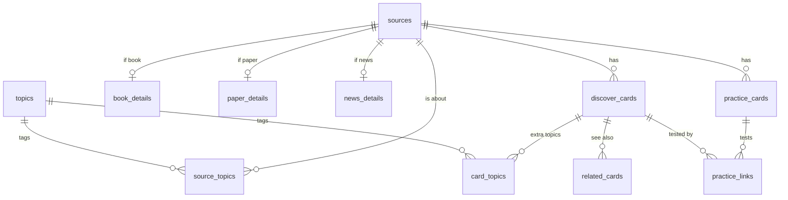
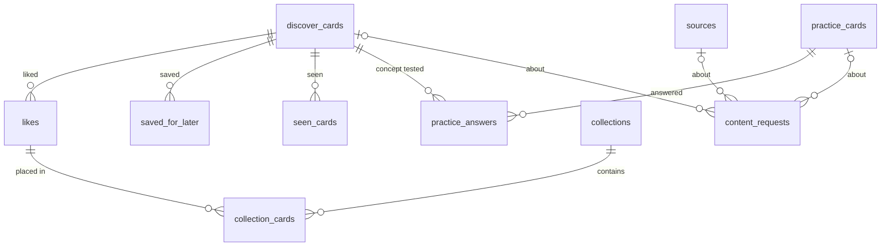
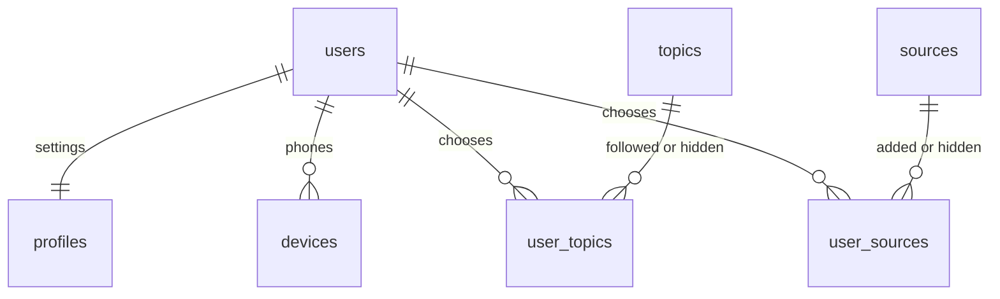

# Database and storage

**Status:** frozen 2026-10-29. Built by ticket 03 on 2026-10-30.

Ticket 12 uses the existing `saved_for_later.resume_at_seconds` column. The
`resume` outbox action updates only an existing row belonging to the signed-in
person; it never re-saves a removed card. Other playback positions stay on the
phone. The per-person phone database upgrades to version 4 with `media_resume`
(card id, nonnegative seconds) and a file classification flag. Existing cached
audio/video files are classified during upgrade. Media files together use at
most one fifth of the offline cap; a smaller mode removes older media files as
needed. Posters and captions use the general cap. Temporary downloads never
appear in the file index, and clearing downloads preserves resume and outbox.

This file explains every table, column, function and storage folder of SmartScrolling, in plain words. The database is Supabase (Postgres). "PK" (primary key) is the column, or pair of columns, that names a row; "FK" (foreign key) points at a row in another table.

## In one sentence

Sources are tagged with topics and contain cards. Discover cards are read, liked or saved for later; practice cards test the Discover cards you liked, on a timetable. Everything you do in the app is stored in your own rows.

## Who writes what

| Data | Who writes it |
|---|---|
| Content tables (11) and both buckets | Only the owner's upload tool, which uses the service-role key |
| Activity tables (11) | The app, for the signed-in person only (each person only their own rows) |
| `auth.users` (shown as `users`) | Supabase itself (Google sign-in). The app never edits it. |

## Maps

Read a line as "one ⟶ many"; a small circle means "may have none".







Not drawn: a sub-topic points to its main area through `topics.parent_id`, and every activity table also has a `user_id` pointing at the person.

## Content tables (you upload)

The 11 content tables are written only by the upload tool. Ids are readable names you write: `happiness-advantage` for a source, `happiness-advantage/tetris-quote` for a card (lowercase words joined by hyphens; a card id starts with its source id and a slash).

### topics

One row is one topic: a main area (no parent) or a sub-topic under a main area. A main area has no sub-topics or at least 2; the upload tool refuses a single one.

| Column | Type | Key | Meaning / example |
|---|---|---|---|
| `id` | text | PK | computer-science, artificial-intelligence |
| `name` | text |  | Computer science (CS) |
| `parent_id` | text | FK → topics | empty for a main area; for a sub-topic: its main area; may be empty |
| `position` | int |  | order in lists; default `0` |

### sources

One row is one source: a book, a paper, a news article or anything else.

| Column | Type | Key | Meaning / example |
|---|---|---|---|
| `id` | text | PK | happiness-advantage |
| `kind` | text |  | one of book, paper, news, other |
| `title` | text |  | The Happiness Advantage |
| `authors` | text[] |  | {Shawn Achor}; default `'{}'` |
| `published_on` | date |  | 2010-09-14; may be empty |
| `language` | text |  | en; default `'en'` |
| `link` | text |  | web address of the source (optional); may be empty |
| `description` | text |  | one to three sentences for the source page (optional); may be empty |
| `cover_path` | text |  | media bucket: sources/happiness-advantage/cover.jpg (optional); may be empty |
| `original_path` | text |  | source-files bucket: happiness-advantage/original.pdf (optional); may be empty |
| `text_path` | text |  | source-files bucket: happiness-advantage/text.txt, the extracted text (optional); may be empty |
| `status` | text |  | draft = not shown yet; published = shown in the app; hidden = taken out of the app but kept; one of draft, published, hidden; default `'draft'` |
| `is_sample` | boolean |  | true = fake test content, removed by the purge command; default `false` |
| `created_at` | timestamptz |  | when the row was made; default `now()` |
| `updated_at` | timestamptz |  | when the row last changed; default `now()` |

### book_details

One row adds the book-only facts to a source of kind `book`.

| Column | Type | Key | Meaning / example |
|---|---|---|---|
| `source_id` | text | PK, FK → sources | happiness-advantage |
| `isbn` | text |  | 9780307591562; may be empty |
| `publisher` | text |  | Crown Business; may be empty |
| `edition` | text |  | 1st edition; may be empty |
| `pages` | int |  | 256; may be empty |

### paper_details

One row adds the paper-only facts to a source of kind `paper`.

| Column | Type | Key | Meaning / example |
|---|---|---|---|
| `source_id` | text | PK, FK → sources | incepholorgb |
| `doi` | text |  | 10.29026/oea.2025.250130; may be empty |
| `journal` | text |  | Opto-Electronic Advances; may be empty |
| `paper_status` | text |  | one of preprint, published, retracted; default `'published'` |

### news_details

One row adds the news-only facts to a source of kind `news`.

| Column | Type | Key | Meaning / example |
|---|---|---|---|
| `source_id` | text | PK, FK → sources | eu-ai-act-guardian-2026-10-29 |
| `newspaper` | text |  | The Guardian; may be empty |
| `show_until` | date |  | after this day its cards leave Discover (they stay in the Library); empty = no end; may be empty |

### source_topics

One row says "this source is about this topic".

| Column | Type | Key | Meaning / example |
|---|---|---|---|
| `source_id` | text | PK, FK → sources | happiness-advantage |
| `topic_id` | text | PK, FK → topics | psychology |

### discover_cards

One row is one Discover card: a short card you read, watch or listen to.

| Column | Type | Key | Meaning / example |
|---|---|---|---|
| `id` | text | PK | happiness-advantage/tetris-quote |
| `source_id` | text | FK → sources | the source it belongs to |
| `format` | text |  | one of concept, quote, news, research, myth, image, video, audio |
| `title` | text |  | The Tetris effect |
| `front` | text |  | what you see first (a myth card: the myth) |
| `back` | text |  | what you see after flipping (a myth card: the fact); may be empty |
| `location` | text |  | Chapter 5, p. 112; may be empty |
| `position` | int |  | order inside the source, used on the source page; may be empty |
| `level` | text |  | one of intro, intermediate, advanced; may be empty |
| `language` | text |  | same as the source unless set; default `'en'` |
| `speaker` | text |  | who said it; quotes only, and required for quotes; may be empty |
| `media_path` | text |  | media bucket: cards/happiness-advantage/tetris-diagram/image.webp; may be empty |
| `media_alt` | text |  | what the image or video shows, for screen readers; may be empty |
| `captions_path` | text |  | media bucket: subtitles (.vtt) for video and audio; may be empty |
| `transcript` | text |  | everything said in the video or audio; may be empty |
| `poster_path` | text |  | media bucket: video thumbnail; may be empty |
| `duration_seconds` | int |  | length of the video or audio; may be empty |
| `version` | int |  | goes up each time the card's content changes; default `1` |
| `status` | text |  | draft = not shown yet; published = shown in the app; hidden = taken out of the app but kept; one of draft, published, hidden; default `'draft'` |
| `created_at` | timestamptz |  | when the row was made; default `now()` |
| `updated_at` | timestamptz |  | when the row last changed; default `now()` |

### card_topics

One row gives a single card an extra topic, on top of its source's topics.

| Column | Type | Key | Meaning / example |
|---|---|---|---|
| `discover_card_id` | text | PK, FK → discover_cards | happiness-advantage/tetris-concept |
| `topic_id` | text | PK, FK → topics | neuroscience |

### related_cards

One row links two cards about the same idea ("see also"). It works both ways.

| Column | Type | Key | Meaning / example |
|---|---|---|---|
| `discover_card_id` | text | PK, FK → discover_cards | one card of the pair (the smaller id) |
| `related_card_id` | text | PK, FK → discover_cards | the other card of the pair (the larger id) |

### practice_cards

One row is one test: a flashcard, multiple choice, true/false, ordering or matching.

| Column | Type | Key | Meaning / example |
|---|---|---|---|
| `id` | text | PK | happiness-advantage/tetris-flash-1 |
| `source_id` | text | FK → sources | the source it belongs to |
| `type` | text |  | one of flashcard, multiple_choice, true_false, ordering, matching |
| `prompt` | text |  | the question, statement or instruction |
| `answer` | text |  | flashcard: the back of the card; may be empty |
| `choices` | text[] |  | multiple choice: the options; may be empty |
| `correct_choice` | int |  | multiple choice: the right option (0 = first); may be empty |
| `is_true` | boolean |  | true/false: the right answer; may be empty |
| `correct_order` | text[] |  | ordering: items in the right order (the app shuffles them); may be empty |
| `match_left` | text[] |  | matching: the left side; may be empty |
| `match_right` | text[] |  | matching: the right side, same order as the left (the app shuffles it); may be empty |
| `explanation` | text |  | shown after you answer (optional); may be empty |
| `version` | int |  | goes up each time the content changes; default `1` |
| `status` | text |  | draft = not shown yet; published = shown in the app; hidden = taken out of the app but kept; one of draft, published, hidden; default `'draft'` |
| `created_at` | timestamptz |  | when the row was made; default `now()` |
| `updated_at` | timestamptz |  | when the row last changed; default `now()` |

### practice_links

One row says "this test checks this Discover card".

| Column | Type | Key | Meaning / example |
|---|---|---|---|
| `discover_card_id` | text | PK, FK → discover_cards | happiness-advantage/tetris-quote |
| `practice_card_id` | text | PK, FK → practice_cards | happiness-advantage/tetris-flash-1 |

## Activity tables (the app writes)

The 11 activity tables hold what each person does. The app writes them for the signed-in person only, and each person sees only their own rows.

### profiles

One row per person: settings that follow you on every phone.

| Column | Type | Key | Meaning / example |
|---|---|---|---|
| `user_id` | uuid | PK, FK → users | the person this row belongs to; default `auth.uid()` |
| `languages` | text[] |  | Discover shows only cards in these languages; default `'{en}'` |
| `preferred_level` | text |  | one of intro, intermediate, advanced; may be empty |
| `discover_filter` | text |  | one of mix, concept, quote, news, research, myth, image, video, audio; default `'mix'` |
| `practice_filter` | text |  | one of mix, flashcard, multiple_choice, true_false, ordering, matching; default `'mix'` |
| `weekly_goal_days` | int |  | 3 = practise three days a week; empty = no goal; from 1 to 7; may be empty |
| `revision` | bigint |  | goes up on every save (trigger); default `1` |
| `created_at` | timestamptz |  | when the row was made; default `now()` |
| `updated_at` | timestamptz |  | when the row last changed; default `now()` |

### devices

One row per person per phone: settings for that phone only.

| Column | Type | Key | Meaning / example |
|---|---|---|---|
| `user_id` | uuid | PK, FK → users | the person this row belongs to; default `auth.uid()` |
| `installation_id` | uuid | PK | created by the app on first launch |
| `offline_mode` | text |  | one of online_only, light, standard, extended; default `'standard'` |
| `download_on_mobile_data` | boolean |  | false = downloads only on Wi-Fi; default `false` |
| `theme_mode` | text |  | one of system, light, dark; default `'system'` |
| `reduce_motion` | boolean |  | true = fewer animations; default `false` |
| `high_contrast` | boolean |  | true = stronger colors; default `false` |
| `text_scale` | numeric(3, 2) |  | text size, a multiplier on the phone's own size, 1.0 = normal; from 0.8 to 1.8 (the app offers 0.85, 0.92, 1.0, 1.1, 1.2); default `1.0` |
| `reminder_time` | time |  | 20:30; empty = no reminder; may be empty |
| `last_sync_at` | timestamptz |  | last time this phone synced; may be empty |
| `revision` | bigint |  | goes up on every save (trigger); default `1` |

### user_topics

One row says a person follows or hides a topic.

| Column | Type | Key | Meaning / example |
|---|---|---|---|
| `user_id` | uuid | PK, FK → users | the person this row belongs to; default `auth.uid()` |
| `topic_id` | text | PK, FK → topics | psychology |
| `choice` | text |  | one of follow, hide |

### user_sources

One row says a person added a source to their feed ("follow") or hid it.

| Column | Type | Key | Meaning / example |
|---|---|---|---|
| `user_id` | uuid | PK, FK → users | the person this row belongs to; default `auth.uid()` |
| `source_id` | text | PK, FK → sources | incepholorgb |
| `choice` | text |  | follow = "Add to my feed"; one of follow, hide |

### likes

One row is one card you liked, with its review timetable and your note.

| Column | Type | Key | Meaning / example |
|---|---|---|---|
| `user_id` | uuid | PK, FK → users | the person this row belongs to; default `auth.uid()` |
| `discover_card_id` | text | PK, FK → discover_cards | the Discover card |
| `liked_at` | timestamptz |  | when you liked it; default `now()` |
| `note` | text |  | your private note (optional); may be empty |
| `review_level` | smallint |  | gap until next test: 1·3·7·14·30 days; from 0 to 4; default `0` |
| `next_review_at` | timestamptz |  | the first test is 1 day after the like; default `now() + interval '1 day'` |
| `last_reviewed_at` | timestamptz |  | when you last answered a test for it; may be empty |
| `reviews_paused` | boolean |  | true = keep it in the Library but stop testing it; default `false` |

### saved_for_later

One row is one card you saved for later.

| Column | Type | Key | Meaning / example |
|---|---|---|---|
| `user_id` | uuid | PK, FK → users | the person this row belongs to; default `auth.uid()` |
| `discover_card_id` | text | PK, FK → discover_cards | the Discover card |
| `saved_at` | timestamptz |  | when you saved it; default `now()` |
| `resume_at_seconds` | int |  | where you stopped a video or audio; may be empty |

### seen_cards

One row records when a card was on your screen. Discover prioritizes new cards and brings seen cards back according to D46; liked and saved cards stay out of the feed.

| Column | Type | Key | Meaning / example |
|---|---|---|---|
| `user_id` | uuid | PK, FK → users | the person this row belongs to; default `auth.uid()` |
| `discover_card_id` | text | PK, FK → discover_cards | the Discover card |
| `first_seen_at` | timestamptz |  | the first time it was on your screen; default `now()` |
| `last_seen_at` | timestamptz |  | the last time it was on your screen; default `now()` |

### practice_answers

One row is one answer you gave to a test. Answers are kept forever.

| Column | Type | Key | Meaning / example |
|---|---|---|---|
| `id` | uuid | PK | made by the phone, so a retry is never counted twice |
| `user_id` | uuid | FK → users | the person this row belongs to; default `auth.uid()` |
| `practice_card_id` | text | FK → practice_cards | the practice card |
| `practice_card_version` | int |  | which version of that test was answered |
| `discover_card_id` | text | FK → discover_cards | the liked card this review was for |
| `answer` | jsonb |  | what you answered: the option, your order, your pairs; may be empty |
| `result` | text |  | one of correct, wrong, again, hard, good, easy |
| `answered_at` | timestamptz |  | when you answered, by the phone clock |

### collections

One row is one of your folders of liked cards.

| Column | Type | Key | Meaning / example |
|---|---|---|---|
| `id` | uuid | PK | default `gen_random_uuid()` |
| `user_id` | uuid | FK → users | the person this row belongs to; default `auth.uid()` |
| `name` | text |  | For my thesis; 1 to 60 characters |
| `created_at` | timestamptz |  | when the row was made; default `now()` |

### collection_cards

One row puts one liked card into one collection.

| Column | Type | Key | Meaning / example |
|---|---|---|---|
| `collection_id` | uuid | PK, FK → collections | the collection |
| `discover_card_id` | text | PK, FK → likes | the Discover card |
| `user_id` | uuid | FK → collections, FK → likes | the person this row belongs to; default `auth.uid()` |
| `added_at` | timestamptz |  | when the card was put in the collection; default `now()` |

### content_requests

One row is one to-do for the owner: a reported mistake or a request for more cards or tests.

| Column | Type | Key | Meaning / example |
|---|---|---|---|
| `id` | uuid | PK | default `gen_random_uuid()` |
| `user_id` | uuid | FK → users | the person this row belongs to; default `auth.uid()` |
| `kind` | text |  | one of problem, more_cards, more_practice |
| `source_id` | text | FK → sources | the source it belongs to; may be empty |
| `discover_card_id` | text | FK → discover_cards | the Discover card; may be empty |
| `practice_card_id` | text | FK → practice_cards | the practice card; may be empty |
| `message` | text |  | what you wrote (optional); may be empty |
| `status` | text |  | open = waiting for the owner; done = handled; dismissed = closed without a change; one of open, done, dismissed; default `'open'` |
| `created_at` | timestamptz |  | when the row was made; default `now()` |
| `resolved_at` | timestamptz |  | when the owner marked it done or dismissed; may be empty |

## Sign-in

- You sign in with Google. Anyone who signs in can use the app: there is no invite list (D06). The access rules keep each person's rows separate.
- Without signing in, the app sees nothing.
- Agents use a test login that exists only in debug builds: the email `agent@smartscrolling.test` with a password made in ticket 03. Both are kept only in the gitignored `.env` and `.env.test.json`, and the **Test login** button appears only in debug builds when those values are present (A3-8).
- The Email provider is used only by that test login. The app shows only Google, and email confirmation stays on.

## Rules the database checks by itself

Ids and names
- A topic id and a source id are lowercase words joined by hyphens (`happiness-advantage`).
- A card id (Discover or practice) is `<source id>/<card name>`, and it must start with its own source id.
- A collection name is 1 to 60 characters, and one person cannot have two collections with the same name.

Topics
- Topics have two levels: a sub-topic's parent must be a main area, and a sub-topic cannot have sub-topics of its own.
- A topic cannot be its own parent.
- A topic that is still used (as a parent, on a source or on a card) cannot be deleted.

Sources and their details
- `kind` is book, paper, news or other; `status` is draft, published or hidden.
- Book, paper and news details can only be added to a source of the matching kind.
- File paths must sit in the source's own folder: the cover under `sources/<source id>/` in `media`; the original and the text under `<source id>/` in `source-files`.
- A book's page count is more than 0.
- `updated_at` is set by itself on every change.

Discover cards
- A quote card must have a speaker.
- Image, video and audio cards must have a media file.
- Media, captions and poster paths must sit in the card's own folder, `cards/<card id>/` in `media`.
- A news card must come from a news source.
- A video or audio length is more than 0 seconds.
- `version` goes up by itself when the card's content changes (a status change alone does not count). `updated_at` is set by itself.

Related cards
- A pair is stored once, with the smaller id first; it works both ways.

Practice cards
- Each type must have its own fields: a flashcard has an answer; multiple choice has 2 to 6 choices and a right choice among them; true/false has its right answer; ordering has at least 2 items; matching has at least 2 left items and as many right items as left items.
- `version` goes up by itself when the content changes. `updated_at` is set by itself.

Your rows
- Profile and phone settings: `revision` goes up by itself on every save, so a save based on an old revision changes nothing. The profile's `updated_at` is set by itself.
- Allowed values: languages and filters as listed above; a weekly goal of 1 to 7 days; a text size from 0.8 to 1.8; a review level from 0 to 4.
- The first test of a like comes 1 day after the like.
- A video or audio resume position is 0 or more seconds.
- A collection can only hold cards you liked, and only your own collection.
- A `more_practice` to-do must name a Discover card; a `more_cards` to-do must name a source.
- There is never more than one open `more_practice` to-do for the same person and card.

What happens on delete ("cascade" means the rows under it go too)
- Deleting a source deletes its details, its topic tags, its cards, its tests and everything that points to them.
- Deleting a Discover card deletes its extra topics, related links, test links, likes, saved and seen marks, answers and to-dos about it.
- Deleting a practice card deletes its links, answers and to-dos about it.
- Deleting a like (unlike) takes the card out of your collections. Your past answers stay.
- Deleting a collection deletes its card list (not the likes).
- Deleting a person (in Supabase Auth) deletes all their rows.
- Real content is never deleted, only hidden. Only sample content is deleted (D41).

Access (row level security, on all 22 tables)
- Signed-in people read published sources and their details and topic tags, and published cards and tests of published sources.
- Signed-in people read all topics, extra card topics, related links and test links.
- Each person reads and writes only their own activity rows.
- Nobody but the upload tool (service-role key) writes content.
- The anon role (not signed in) gets nothing at all.

The exact access rules are:

```sql
-- Turn on row level security for all 22 public tables (repeat for each table name).
alter table public.topics enable row level security;
-- … sources, book_details, paper_details, news_details, source_topics, discover_cards, card_topics,
--   related_cards, practice_cards, practice_links, profiles, devices, user_topics, user_sources, likes,
--   saved_for_later, seen_cards, practice_answers, collections, collection_cards, content_requests

-- CONTENT: signed-in people read what is published. Nobody but the upload tool (service-role key) writes.
create policy "read published" on public.sources for select to authenticated
  using (status = 'published');
create policy "read published" on public.discover_cards for select to authenticated
  using (status = 'published'
         and exists (select 1 from public.sources s where s.id = source_id and s.status = 'published'));
create policy "read published" on public.practice_cards for select to authenticated
  using (status = 'published'
         and exists (select 1 from public.sources s where s.id = source_id and s.status = 'published'));
create policy "read published" on public.book_details for select to authenticated
  using (exists (select 1 from public.sources s where s.id = source_id and s.status = 'published'));
-- the same "read published" policy for paper_details, news_details and source_topics
create policy "read all" on public.topics for select to authenticated using (true);
-- the same "read all" policy for card_topics, related_cards and practice_links

-- ACTIVITY: each person reads and writes only their own rows.
create policy "own rows" on public.likes for all to authenticated
  using (user_id = (select auth.uid())) with check (user_id = (select auth.uid()));
-- the same "own rows" policy for profiles, devices, user_topics, user_sources, saved_for_later,
--   seen_cards, practice_answers, collections, collection_cards and content_requests

-- Nothing at all for the anon role: without signing in, the app sees nothing.
```

## How it behaves

| Situation | What happens |
|---|---|
| Who writes what | Content tables and both buckets: only the upload tool. Activity tables: the app, each person only their own rows. Multi-step actions (Like, an answer) run as one database function, so they never half-happen. |
| Like | Adds a `likes` row (first test 1 day later; a repeated Like keeps the existing timetable), removes the card from `saved_for_later`, marks it seen, and adds one `more_practice` to-do if the card has no published linked test. |
| Unlike | Deletes the like with its timetable and note; past answers stay; collection memberships go (cascade). Undo right after restores everything exactly (D40, A3-12). |
| For later | Adds or refreshes a `saved_for_later` row and marks the card seen. |
| Picking a test | From the published practice cards linked to the liked card that match the Practice filter: one you never answered first, otherwise the one you answered longest ago (D32). |
| No new tests left | After an answer, if every linked published test has been answered at least once, add one `more_practice` to-do (never two open ones for the same card: unique index). |
| Timetable | Computed in the app by `lib/domain/review_schedule.dart` (A3-3): correct or good → one step up; easy → two steps; hard → stays; wrong or again → level 0 (1 day). Levels 0–4 = 1 · 3 · 7 · 14 · 30 days. The server keeps the result of the answer with the latest `answered_at`. |
| Discover feed | D34 + A3-5 + D46. With nothing followed: all eligible published cards (minus hidden, other languages, expired news, Liked and For later cards). New cards come first; seen cards return according to the interleaving rule below. |
| Editing content | Re-uploading the same ID updates the row; the `bump_version` trigger raises `version` when content changes. Answers keep the version they were for. |
| Removing content | Real content: set `status = 'hidden'`, never delete. Sample content (`is_sample`): `upload.py purge-samples` deletes the sources; everything under them goes through `on delete cascade`, and their storage folders are removed by the tool. |
| Saving settings | Plain update `… where user_id = me and revision = <the revision the app loaded>`; the trigger raises `revision`. No row updated = someone saved first, so the app reloads (A3-14). |

## Functions

Each comes in a migration plus a line here. All use `security invoker` and `set search_path = ''`, so the access rules above still apply.

| Function | Added by | What it does | Status |
|---|---|---|---|
| `discover_feed(p_limit int default 20, p_exclude text[] default '{}') returns setof discover_cards` | 04 | The feed (D34, A3-5), leaving out `p_exclude` ids. It reads the person's profile: `languages`, `preferred_level` and `discover_filter` (Mix or one format). "Following nothing" means no `follow` row in `user_topics` or `user_sources`. A hidden main area hides its sub-topics too, and hiding beats following. Order: preferred level first, then the sum of topic counts among the person's Likes (source and extra card topics, each Like counted once per topic), then sources take turns within that level/score by `sources.created_at`, newest first. Likes never override eligibility or hide rules. Seen cards come back (D46): new cards first in that order, then one seen card after every 10 new ones, the one seen longest ago first (`seen_cards.last_seen_at`); once new cards run out only seen ones remain. Liked and For later cards never come back. | built (tickets 04, 07, 18) |
| `search_sources(p_text text default '', p_topic text default null) returns table(source jsonb, card_count bigint)` | 07 | Published sources with published card counts. Literal, case-insensitive substring search in title, individual authors, topic and main-area names. Optional main-area/topic filter includes sub-topics. Stable title/id order supports range paging. Uses the caller's RLS; only authenticated people can call it. | built (ticket 07) |
| `like_card(p_card_id text) returns likes` | 04 | The Like row above; refuses a card the person cannot read (error P0002) | built (ticket 04) |
| `save_for_later(p_card_id text) returns saved_for_later` | 04 | The For later row above; refuses a card the person cannot read (error P0002) | built (ticket 04) |
| `undo_like(p_card_id text, p_saved_at timestamptz default null) returns void` | 04 | Deletes the like; if `p_saved_at` is given, puts the card back in For later with that time | built (ticket 04) |
| `pick_test(p_discover_card_id text, p_filter text default 'mix') returns practice_cards` | 06, 10 | Picks for the person's own, unpaused Like: never answered first, then oldest most recent answer, then id for ties. History is per person and test, including answers through other linked concepts. Returns null if none match. Mix and explicit filters support all five types (ticket 10). Offline, the phone picks with the same rule (`lib/domain/test_picker.dart`); `supabase/tests/pick_test_cases.sql` holds the cases both must pass. | built (tickets 06, 10) |
| `record_answer(p_id uuid, p_practice_card_id text, p_practice_card_version int, p_discover_card_id text, p_answer jsonb, p_result text, p_answered_at timestamptz, p_review_level smallint, p_next_review_at timestamptz) returns likes` | 06 | Inserts the answer once (same id twice changes neither answer nor timetable). Locks the person's Like and updates its timetable only when `p_answered_at` is strictly newer; older answers remain in history. Requires an own Like and a readable linked test; accepts versions 1 through the current version. Validates level and finite dates, with next date after answer time. Adds one open `more_practice` to-do only when all linked published tests, across all types, have been answered. Offline answers reach it later from the phone's outbox with the same id (ticket 09). | built (ticket 06) |
| `export_my_data() returns jsonb` | 13 | All of the person's own rows from all 11 personal tables, one array per table (including empty arrays); includes settings and every device | built (ticket 13) |
| `delete_my_data() returns void` | 13 | Atomically deletes the person's activity rows except `profiles` and `devices`, which are preserved and reset to column defaults; their revision triggers still run. Account and content stay | built (ticket 13) |

Simple actions (mark seen, unlike, remove from For later, pause reviews, notes, collections, follow/hide, reports) are plain inserts, updates or deletes on the person's own rows.

Ticket 13 adds `20261031160000_your_data.sql`. Both data functions explicitly require `auth.uid()`, accept no user id, use invoker rights and an empty search path, and grant execution only to authenticated callers. Every read/write also filters by that identity. `supabase/tests/your_data.sql` verifies all 11 export keys, row isolation, reset defaults on multiple devices, preserved accounts/content, repeat deletion and denied anonymous access in a rolled-back transaction with temporary people. The app syncs queued activity before exporting. Confirmed deletion stops background sync and atomically replaces this phone's activity/outbox/resume cache with a durable `delete_data` request. Its new outbox id invalidates older snapshots; the request retries until acknowledged, including when a committed RPC response was lost. Successful deletion cancels the reminder and reloads default settings. Progress pages the caller's Likes and this local week's answers; reminder time is per installation, weekly goal is per person.

Ticket 06 adds `practice_answers_test_history` on `(user_id, practice_card_id, answered_at desc)` so picking a test can find each person's most recent answer quickly. Both Practice functions are executable only by `authenticated`, use the caller's row access rules, and never accept a user id from the app. The Like row lock serializes competing answers; equal timestamps keep the first stored timetable. A duplicate id owned by another person is refused.

## Storage

Both buckets are private and accept files up to 50 MB.

- `source-files`: only the upload tool reads or writes it. It has no access rule, so only the service-role key can use it.
- `media`: the app reads it while you are signed in, through signed links valid for 1 hour (A3-7).

```sql
insert into storage.buckets (id, name, public, file_size_limit)
values ('source-files', 'source-files', false, 52428800),
       ('media', 'media', false, 52428800)
on conflict (id) do nothing;

create policy "signed-in users read media" on storage.objects for select to authenticated
  using (bucket_id = 'media');
-- source-files has no policy: only the service-role key (the upload tool) can read or write it.
```

Folders. Each column stores the path inside its bucket, without the bucket name. A card's folder name is its ID.

```
source-files/                                  private, only the upload tool
└── happiness-advantage/
    ├── original.pdf          ← sources.original_path   (original.pdf | .epub | .html | .txt)
    └── text.txt              ← sources.text_path       (the extracted full text)

media/                                         private, the app reads it while signed in (signed URLs, 1 hour)
├── sources/
│   └── happiness-advantage/
│       └── cover.jpg         ← sources.cover_path      (cover.jpg | .png | .webp)
└── cards/
    └── happiness-advantage/
        ├── tetris-diagram/
        │   └── image.webp    ← discover_cards.media_path    (image.webp | .jpg | .png)
        └── achor-ted-talk/
            ├── video.mp4     ← discover_cards.media_path    (video.mp4; audio: audio.m4a | .mp3 | .wav)
            ├── poster.jpg    ← discover_cards.poster_path
            └── captions.vtt  ← discover_cards.captions_path
```

## Changing the database

Tables, columns and buckets are frozen; only the owner changes them. Functions and indexes may be added. Every change is a new file in `supabase/migrations/` named by purpose, plus an update to this file in the same commit.

## The exact SQL

The exact definition is in `supabase/migrations/`:
- `20261030100000_helpers.sql`: the trigger functions (`touch_updated_at`, `bump_version`, `bump_revision`, `check_topic_levels`, `check_source_kind`, `check_news_card`);
- `20261030100100_content_tables.sql` and `20261030100200_activity_tables.sql`: the 22 tables, with every meaning above stored as a table or column comment;
- `20261030100300_access_rules.sql`: row level security on all 22 tables; the anon role also loses every table privilege;
- `20261030100400_storage.sql`: the two buckets and the media read rule.
- `20261030110000_discover_functions.sql`: `discover_feed`, `like_card`, `save_for_later` and `undo_like` (only signed-in people may call them).

Run a SQL file on the live project with `python supabase/run_sql.py <file>`; add `--migration` for a new migration, so it is recorded in the migration history. The access tests are `supabase/tests/access_rules.sql`; the feed and Like / For later tests are `supabase/tests/discover_feed.sql`.

- `20261030130000_explore_personalization.sql`: replaces `discover_feed` with Like affinity after level match, and adds `search_sources`. No table, column or bucket changed. Verify with `supabase/tests/discover_feed.sql` (rollback only).
- `20261103120000_text_scale_range.sql`: widens the `devices.text_scale` check to 0.8–1.8 for the smaller text sizes (ticket 17). No row changed.
- `20261103130000_discover_feed_repeats.sql`: replaces `discover_feed` so seen cards come back after new ones, and liked or saved cards never do (ticket 18, D46). Verify with `supabase/tests/discover_feed.sql`.
